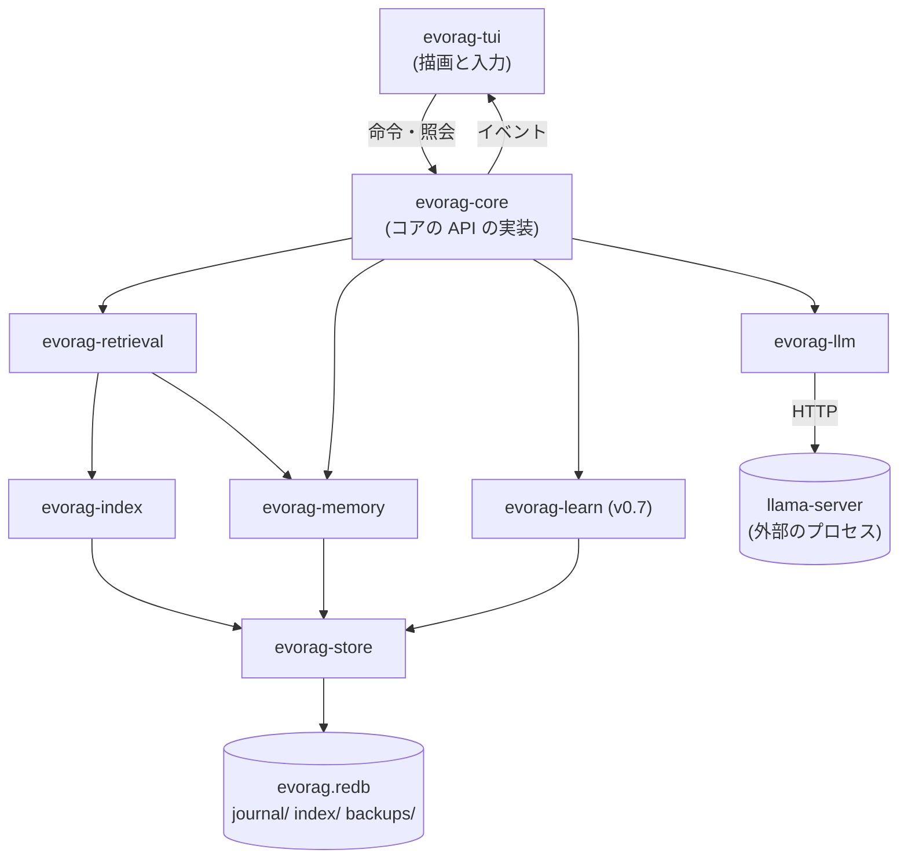

# 02. アーキテクチャ (Architecture)

| 項目 | 内容 |
|---|---|
| 文書ID | 02-architecture |
| 状態 | ドラフト |
| 前提 | [00-overview](00-overview.md) / [01-requirements](01-requirements.md) |
| 正本の概念 | プロセスの構成、コアの API (命令・イベント・照会)、crate の構成と依存の規則、スレッドとタスク、決定性のための注入、エラーとログ、脅威モデル |
| 主対象 crate | 全体 |

---

## 1. プロセス

- `evorag` を起動すると、TUI とコアが **1 つのプロセス** で動く。TUI を閉じるとコアも止まる (確定、[ADR-0003](10-decisions.md#adr-0003-tui-とコアを-1-つのプロセスで動かす))。
- 1 つのデータ根を使えるプロセスは 1 つだけ (03 §9)。サブコマンドも同じロックを取る。
- 常駐 (daemon) とエディタ連携専用のモードは作らない (v1.0 の前に採否を決める、OQ-25)。後で分けるときは、§3 のコアの API をそのままプロセスの外へ出す。

## 2. 全体図

## 3. コアの API

画面の種類に依存しないように、コアと画面の間を次の 3 つで切る。型はすべて `evorag-types` に置く。

| 区分 | 向き | 中身 (例) |
|---|---|---|
| **命令** (Command) | 画面 → コア | 発話する、中断する、再生成する、セッションを開く・作る・改名する・消す、評価する、事実を忘れる・private にする (v0.3 から、private を解く・矛盾の値を採る・履歴の値に戻す・再び覚えない印を解く。忘れるは、対象と選択を渡して見本を求める命令と、見本の計画のハッシュを添えて実行する命令の 2 つ、04 §7.1。見本は読み取りだが、ほかのターンを探すのに時間がかかり、実行の命令が古い見本を断ったときにも返すので、照会ではなく命令とイベントで扱う)、出典の範囲を変える、答え方の既定を選ぶ (v0.2)、入力が止まったことを知らせる (v0.2、先に済ませる処理の合図)、候補の帯の往復を添えて作り直す・「無関係」の印を付ける (v0.2)、古い根を消す (v0.5。取り込みの後の最初の忘れる・削除の前、03 §10.2)、学習の採用を承認する・巻き戻す (v0.7) |
| **イベント** (Event) | コア → 画面 | トークンの断片、応答の完了・中断・失敗、添えたメモリ (とカートリッジ) の出典、候補の帯 (v0.2)、想起の縮退の状態 (v0.2)、モデルの照合の結果 (記録と違う、v0.2)、裏の処理の状態と進み具合、学習の提案と採用、警告とエラー、接続の状態、忘れるの見本 (見本の本文・件数・警告・計画のハッシュ、v0.3)、開いているセッションのターンに伏せ字か `[非表示]` の範囲ができたこと (セッションとターン、v0.3) |
| **照会** (Query) | 画面 → コア → 画面 | セッションの一覧、セッションのターン (v0.3 から、伏せ字と `[非表示]` の印の範囲と種類を添える。本文は保存したまま、04 §7.3)、事実の一覧 (v0.3 から、置き換えの履歴と忘れた事実の一覧も。v0.5 から単位の一覧と、残りの区切りの数・古い根の処分の状態)、出典の詳細、直前の応答の想起の詳細 (`/memory`、v0.2)、モデルの記録と繋がっているモデル (`/model`、v0.2)、答え方の既定 (v0.2)、precept の履歴、点検の結果。読み取り用の型だけを返す |

**決めごと**:
1. コアは表示用の文字列を作らない。利用者に見せる文言は文言キーと引数 (`MessageKey` と値) で返し、画面が訳す (07 §6)。
2. 画面に依存する整形 (色・折り返し・キー操作) は、すべて画面の側で行う。TUI 専用の機能をコアに置かない。
3. 命令は型付きの enum で、追加だけで広げる (既存の値の意味を変えない)。イベントと照会の型も同じ。v0.1 の「モデルを切り替える」の命令は、v0.2 で外す (切り替えは `evorag setup` だけ、[ADR-0018](10-decisions.md#adr-0018-モデルは-setup-で記録し切り替えは-setup-でだけ行う)。契約を固める前なので外せる、5.)。
4. イベントは順序を保つ 1 本の流れ (チャネル) で届く。画面は購読して描画するだけにする。
5. **契約の固定**: v0.1〜v0.6 の間、コアの API は同じプロセスの中だけで使うので、版の間で変えてよい (`evorag-types` は crates.io に公開しない)。プロセスの外へ出すときに「契約の版 1」として固定し、以後は足すだけにする (確定、[OQ-25](10-decisions.md#oq-25-コアの-api-の契約を固める時期))。

## 4. crate の構成

### 4.1 一覧

| crate | 役割 | 主な依存 | 入る版 |
|---|---|---|---|
| `evorag-types` | ID、時刻、エラー、文言キー、コアの API の命令・イベント・照会の型 | serde | v0.1 |
| `evorag-llm` | llama-server のクライアント (chat・embed・rerank・tokenize・props・slots) | reqwest (TLS なし)、serde_json | v0.1 |
| `evorag-store` | redb の表、封筒、スキーマの版と移行、書き手スレッド、`WriteToken`、ジャーナル、退避、ロック、伏せ字の純粋な核 (04 §7.2)、ファイルの操作の道具 (`fsutil`。上書きしない改名・ロックの再試行。`evorag-update` も使う)。v0.5 から、データ根を消す手順 (`reset` と古い根の処分の共通の実装、03 §10.2)、`import-v04` の土台 (古い根を読むだけで開く・新しい根を作る・照合・入れ替え、03 §12.4。種類を写して変える中身は `evorag-memory` が渡す) | redb、ciborium、xxhash-rust、sha2・unicode-segmentation (伏せ字の核、v0.3) | v0.1 |
| `evorag-index` | 語彙の索引とベクトルの索引、セグメントの形式と入れ替え | memmap2、rayon、arc-swap | v0.1 (語彙) / v0.2 (ベクトル) |
| `evorag-memory` | メモリの書き込み・統合・読み出し、事実の入口、訂正の検証。v0.5 からは、メモリの新エンジンの **LLM と I/O を持たない純粋な部分** (§4.4): 区切りの決め方と文の分け方 v1、B2 のプロンプトと型と出力の検証、台帳の型 (書くときの型と読むときの型を分ける) と有効性と選び方、関門 (B3)、全件の導出と指紋 (B4)、指示の型と当て方の述語、台帳の掃除、プロファイルの描画、`import-v04` の指示の写し方 | toml、unicode-normalization、unicase (値の鍵の case folding、04 §5.6)、sha2 (値の鍵の HMAC。HMAC は sha2 の上に組む) | v0.1 (ターンとセッション) / v0.2〜v0.3 / v0.5 (新しいエンジン) |
| `evorag-retrieval` | 問いの準備、候補の収集と順位付け、文脈の組み立て | unicode-normalization | v0.1 |
| `evorag-learn` | 学習の輪 (事例・評価・採用・巻き戻し、ADR-0021)。v0.4 の計画の回帰台帳・precept・リプレイ・ゲートは作らない。中身は v0.7 の M7.0 で決める | — | v0.7 |
| `evorag-cartridge` | カートリッジの形式・検証・導入・作成 | zip (圧縮なしの読み書きだけ、既定の機能を切る)、minisign-verify、encoding_rs | v0.9 |
| `evorag-update` | 本体の更新の確認・取得・検証・置き換え・巻き戻し (12 §7) | ureq (`rustls-no-provider`・`platform-verifier`。圧縮の機能は入れない、12 §7.5) + rustls + rustls-graviola (純 Rust の暗号の実装、OQ-05、S-06。graviola は `=` で版を固定する、12 §7.5)、minisign-verify、sha2、serde・serde_json (`release.json` と状態のファイル)。配布物の読み手は zip (deflate だけ。既定の機能を切る) と tar + flate2 (`rust_backend` の miniz_oxide)。どの読み手で読むかは配布物の名前の末尾で決める (12 §5.3。`cfg` では決めない)。読み手を入れるのは、その形式を読む対象だけでよい。推移的な依存の数が上限 (09 §7) を超えるときは、`exe` の 1 項目を取り出すだけの最小の読み手を自前で持つ | v0.3 |
| `evorag-core` | 上を組み立てるコア。コアの API の実装、sleep-time の進行。v0.5 から、段取り (B10)、B2 の呼び出し (`evorag-llm` で呼び、台帳を書き手に送る)、導出と索引とプロファイルの差し替えの時機、忘れる・private の手順の組み立て、`evorag sleep` の前景の実行、`import-v04`・`reset`・`doctor --deep` の手順の組み立て | tokio、tracing、getrandom (`memory.forget_key` を作る OS の乱数、v0.3) | v0.1 |
| `evorag-tui` | TUI | ratatui、crossterm、unicode-width、unicode-segmentation | v0.1 |
| `evorag` (bin) | サブコマンドの入口 (v0.5 から `sleep`・`import-v04`・`reset`・`doctor --deep`) | clap | v0.1 |
| `xtask` (bin、`publish = false`) | 開発用の作業コマンド (check、check-deps、i18n、trace、live-llm) | — | v0.1 |

### 4.2 依存の方向

- 依存は一方向だけ。下の表の上の行の crate は、下の行の crate に依存しない。

| 層 | crate |
|---|---|
| 入口 | `evorag` (bin) |
| 画面 | `evorag-tui` |
| 組み立て | `evorag-core` |
| 機能 | `evorag-retrieval`、`evorag-learn`、`evorag-cartridge`、`evorag-update` |
| 部品 | `evorag-memory`、`evorag-index`、`evorag-llm` |
| 保存 | `evorag-store` |
| 型 | `evorag-types` |

### 4.3 依存の規則 (`deps-policy.toml` で検査する)

| 規則 | 内容 |
|---|---|
| R1 | `evorag-tui` は `evorag-types` と `evorag-core` の公開 API だけを使う |
| R2 | redb を直接使ってよいのは `evorag-store` だけ。他の crate は `evorag-store` の trait (記録の読み書き、関係、副索引、範囲の走査) を使う |
| R3 | HTTP のクライアントを使ってよいのは `evorag-llm` (reqwest) と `evorag-update` (ureq) だけ。`evorag-llm` は TLS を持たない。2 つは別の HTTP のクライアントにする。同じ crate を使うと、配布物の中で機能がまとまり、`evorag-llm` にも TLS が入るため (S-06)。crate ごとの依存の木では見えないので、配布物 (`evorag`) の木で reqwest に TLS の機能 (`__tls`) が無いことも検査する (`evorag-update` を置くときに check-deps に足す) |
| R4 | `evorag-types` の外部依存は serde だけ |
| R5 | C を含む依存は 0。例外は作らない。TLS を使ってよいのは `evorag-update` だけで、暗号の実装は純 Rust のもの (OQ-05) に限る。ring・aws-lc-rs・OpenSSL を依存の木に入れない |
| R6 | 画面を扱う crate (ratatui、crossterm) を使ってよいのは `evorag-tui` だけ |
| R7 | スレッドを作ってよいのは `evorag-core` (書き手スレッドと tokio の実行器) と `evorag-tui` (入力) だけ。重い計算は rayon の pool を使う |
| R8 | (v0.5) `evorag-memory` は `evorag-llm` と `evorag-index` に依存しない (導出・関門・掃除を、LLM の呼び出しと索引から切り離した純粋な関数に保ち、決定性の試験 (09 §3.5) を記録と再生なしで流せるようにするため。今の依存もこの形)。M5.1 で `deps-policy.toml` に足す |

### 4.4 メモリの新エンジンのブロックの置き場所 (v0.5)

ADR-0021 の新しいエンジン (提案書 §4〜§8) のブロックを、今の crate に置く。新しい crate は作らない (今の依存の方向 §4.2 のままで置けるため)。規則の中身の正本は 04、種類の形の正本は 03。

| ブロック | 中身 | 置き場所 | 依存の向き |
|---|---|---|---|
| 区切り | 往復を古い順に詰め、モデルに依らない見積もりで閉じる。区切りの ID | `evorag-memory` (決め方) / `evorag-core` (閉じる時機の判定と書き込みの依頼) | memory → store |
| B2 (1 回の呼び出し) | プロンプト・辞書・型の組み立て、文番号の振り方、出力の解析 | `evorag-memory` (組み立てと解析。純粋) / `evorag-core` (`evorag-llm` で呼び、止める) | core → llm、core → memory |
| 台帳 | `proposal` の型、有効性の判定、使う台帳の選び方、掃除の関数 | `evorag-memory` | memory → store |
| B3 (関門) | 関門 1〜8、文の範囲・主語・極性・数字・機微な情報のふるい、辞書の写しの後の当て直し | `evorag-memory` (規則の TOML を同梱) | — |
| B4 (導出) | 全件の導出、導出の指紋、畳みの規則、`end` の当て方、private の印 | `evorag-memory` (純粋な関数。入力は台帳・指示・辞書・規則の版) / `evorag-core` (起動時の指紋の照合、導き直しの依頼) | memory → store |
| 統治 | 指示 (`directive`) の型と当て方、忘れるの計画、private の手順 | `evorag-memory` (指示の型・当て方・計画) / `evorag-core` (手順の組み立て: 先読みの停止と世代の番号、スロットのキャッシュの消去の要求) / `evorag-store` (伏せ字の核 `apply_forget`、ジャーナルの書き直し、退避の写し直し) | core → memory → store |
| プロファイル | 辞書の属性の `world` の Live の単位から描く「属性: 値」の表 | `evorag-memory` (描画) / `evorag-retrieval` (システムプロンプトの末尾に置く) / `evorag-core` (差し替えの時機) | retrieval → memory |
| 単位の鍵 (v0.5)・単位の索引 (v0.6) | 単位の鍵: 辞書の属性の `world` の Live・Superseded の単位から作る短い語句 (v0.4 の事実の鍵の後継)。単位の索引: 単位の値・自由記述の属性・entity の語彙とベクトルの索引 (単位を想起の候補の由来にするもの)。言葉の区別は 04 §5.5 | 単位の鍵は `evorag-memory` (語句の作り方) / `evorag-index` (今の検索の鍵の索引に足す)。単位の索引は v0.6 で `evorag-index` に作る (v0.5 は読み出しを変えず、忘れるの置き場所を増やさないため。確定、2026-11-26、OQ-54 の 7) | index → store |
| 文の分け方 v1 | 区切りの文番号の分け方 (版を持たせて凍結する、04 §2) | `evorag-memory` (今の `evorag-retrieval::window::sentences` を移す。`evorag-retrieval` が `evorag-memory` に依存するので、B2 から呼べる側に置く)。文の窓 (05 §3.8) は、`evorag-memory` の v1 を呼ぶか、別に持つ (M5.2 で決める) | retrieval → memory |
| B10 (段取り) | 即時・微小待機・応答の後・短い待機・長い待機 (v0.7)・夜間 (v0.8) の階層、1 秒以内の停止と再開 | `evorag-core` (`sleep.rs` の sleep-time を広げる)。`evorag sleep` は同じ段取りを、待機の判定を省いて前景で流す | — |
| `import-v04` | 古い根を読むだけで開く・新しい根を作る・照合・入れ替え / 種類を写して変える (`fact_directive` → `directive`、`end` を足す) | `evorag-store` (土台) / `evorag-memory` (写して変える中身) / `evorag-core` と bin (手順と画面) | core → memory → store |
| `reset`・`doctor --deep` | 消す手順 / 導出のし直しの照合と残りの走査 | `evorag-store` (消す手順・退避とジャーナルの走査の土台) / `evorag-memory` (照合と走査の判定) / `evorag-core` と bin (組み立て) | core → memory → store |
| B11 (学習)・B12 (評価の台) | 学習の輪 (v0.7) / 評価の台 | `evorag-learn` (v0.7) / `xtask` (`live-llm`・`longmemeval`) | — |

- 旧エンジン (v0.4 の抽出・統合・事実の表・ノート・訂正) のコードは、開発中の比較の台 (09 §3.5) が要らなくなるまで残し、v0.5 の判定の前に外す (08 §2.6)。`import-v04` が読む v0.4 の種類 (`fact`・`fact_directive`) の読み手だけは残す。

## 5. スレッドとタスク

| 担当 | 中身 | 実行方式 |
|---|---|---|
| 画面 (TUI) | 描画と入力 | 専用のスレッド |
| チャット経路 | 発話の確定の依頼、文脈の組み立て、検索、生成の受信 | tokio のタスク |
| 先に済ませる処理 (v0.2) | 入力が止まったときの問いの埋め込みとリランク、応答の直後の次のターンの分 (05 §4.5)。チャット経路が始まったら止める | tokio のタスク |
| 書き手 | `evorag.redb` とジャーナルへの書き込み (会話の追記と、裏の処理の結果) | 専用のスレッド 1 本 |
| sleep-time | メモリの統合 (v0.5 からは区切りの B2 → B3 → 導出)、索引の作り直し、退避、学習、モデルの性質の点検 (06 §3.3) | tokio のタスク 1 本 (LLM の呼び出しは直列) |
| `evorag sleep` (v0.5) | sleep-time と同じ段取りを、待機の判定を省いて前景で最後まで流す (07 §5)。TUI は無く、画面のスレッドの代わりに進み具合を標準出力に書く | sleep-time と同じ tokio のタスク |
| 決定論的な重い計算 | 索引の構築、ベクトルの量子化 | rayon |

- **書き込みの入口は 1 つ**: 書き込み用の `WriteToken` は書き手スレッドだけが持つ。チャット経路と sleep-time は、書き込みの依頼 (型付きのメッセージ) を書き手スレッドに送り、結果を待つ。応答の経路に渡すのは読み取り用の型だけ。
- **優先度**: 書き手スレッドは、会話の追記の依頼を裏の処理の結果より先に処理する (2 本の待ち行列)。v0.5 の台帳は裏の処理の待ち行列に入れるが、`Durability::Immediate` で書く (03 §3.4)。
- **終了**: 終了の合図 (TUI を閉じる、Ctrl+C、Windows のコンソールを閉じる (猶予は約 5 秒)、SIGTERM) を受けたら、新しい依頼を止め、書き手スレッドの待ち行列にある会話の追記を書き切ってから終わる。裏の処理の結果は捨ててよい (job から再開できる)。

## 6. 決定性のための注入

- 時刻は `Clock` の trait、ID の生成は `IdGen` の trait で注入する。試験では固定の時計と種を固定した生成器を使う。
- llama-server は `LlmClient` の trait の後ろに置き、試験では記録した応答を再生する実装を使う (09 §3.3)。
- ファイルシステムの障害 (書き込みの失敗・空きの不足・強制終了) は、`evorag-store` の下の層で注入できるようにする (09 §4)。
- 電源の状態 (電池か、つながっているか、v0.2) は `PowerSource` の trait で注入する (04 §4、AC-FR-301-2)。入力が止まったことの合図 (05 §4.5) は、時計と同じく試験で進める。

## 7. エラーとログ

- エラーは crate ごとの型 (`thiserror`) で持ち、コアの API では「文言キー + 分類 (利用者の操作で直る / 設定 / 接続 / データ / 内部)」で返す。
- 利用者に見せるエラーは、何が起きたか・データは無事か・次に何をすればよいかを含む (NFR-604)。
- ログは `tracing` で、状態のフォルダ (03 §2) の `logs/` に書く。ログの文言は英語。
  - 応答ごとに短い追跡 ID を付ける。
  - 判定点の結果 (Fire / Abstain / Skip) を記録する。
  - **会話の本文・事実の値・precept の本文・API キーを出さない**。出すのは ID・長さ・件数・時間だけ (NFR-502)。
  - ログは 7 日分だけ残し、古いものから消す。

## 8. 脅威モデル

### 8.1 前提

- **1 人で使う PC** を前提にする。同じ PC の他の利用者アカウントは信頼しない。管理者権限を持つ攻撃者は対象外。
- llama-server は利用者が自分で起動したもので、既定では同じ PC のループバックで動く。

### 8.2 守るもの

| 守るもの | 脅威 | 対策 | 版 |
|---|---|---|---|
| 会話の本文 | 他の利用者アカウントからの読み取り | データ根・設定・書き出しを、ほかの一般の利用者が読めない権限で作る (Windows は所有者・SYSTEM・Administrators だけ、NFR-503)。管理者は防がない (所有権を取れば読めるため) | v0.1 |
| 会話の本文 | llama-server のふりをする別のプロセスへの送信 (llama-server が止まっている間にポートを取られる) | v0.1: 起動時に `/props` のモデルのパスと model_key を前回と照合し、違えば知らせる。v0.2: 役割ごとにモデルをデータ根に記録し、起動と再接続のたびに照合する。chat が違えば画面を開かず、送信もしない。embed・rerank が違えば使わない (06 §3.1)。setup は `--host 127.0.0.1` と `--api-key` を付けた起動例を示す。model_key は公開の値から作れるので、照合は偽装を確実には防がない (API キーで補う) | v0.1 / v0.2 |
| 会話の本文 | 外部への送信 | 既定ではループバック以外を拒否する (embed・rerank の接続先も同じ)。外部の接続先は設定で明示し、`https` を必須にする (確定、[OQ-23](10-decisions.md#oq-23-ループバック以外の-llama-server-を許すか)) | v0.1 |
| 送っていない入力 | 入力が止まったときに先に済ませる処理 (05 §4.5) で、送る前の文章が llama-server へ出る | ループバック以外を許した設定では、既定で切る (`retrieval.precompute`)。結果は保存しない | v0.2 |
| API キー | 漏洩 | 所有者だけが読める `config.toml` に置き、ログと書き出しから除く | v0.1 |
| 応答の振る舞い | 以前の会話・事実・カートリッジに埋め込まれた指示 (指示の混入) | 信頼しない引用の枠と、要求ごとに変わる区切り (05 §4.3)。事実は利用者の発話だけから抽出し、属性を一覧の内側に限り、値の長さに上限を置き、指示に読める値・改行・表の区切り・URL を書き込みの入口で捨てる (安全の規則はプロンプトの言語に関わらず全言語を当てる)。統合は LLM を使わない決定論の規則で行う (04 §5)。v0.5 から: B2 は利用者の発話の文だけに番号を振り、根拠を文番号で指させる。関門 (B3) で文の範囲・主語・極性・数字・機微な情報を確かめ、`keys` と自由記述の属性にも指示に読める語句の関門を当てる。辞書の写しの後に関門を当て直す。導出は決定論 (04)。プロファイル (システムプロンプトの信頼する枠) には、辞書の属性の `world` の Live の値だけを置き、自由記述の属性と出来事を置かない。LLM の自由な文を文脈に入れない。同梱の攻撃の事例 (応答に誤りを入れた型、貼った文書の要約に指示を入れた型を含む) を守りの試験に入れる (09 §3.5)。カートリッジは信頼しない引用の枠だけに入れる | v0.1 / v0.3 / v0.5 / v0.9 (カートリッジ) |
| システムプロンプト | 学習した指示を経由した注入・安全の劣化 | 安全に関わる指示は固定し、自動の編集の対象外にする。LLM が作る指示の文 (precept) は採らない (ADR-0021)。利用者が書く指示 (v0.8) は、本体の安全の指示を打ち消す言い方と URL を決定論で断る。同梱の安全の回帰事例を必ず流す | v0.8 |
| 単位とプロファイル | Windows の端末で貼った文書の中の言い切りが、利用者の発言として単位になる (貼り付けを見分けられない、04 §5.2 の前のふるい・S-16) | 既知の穴として約束しない範囲に書く (04 §7.8)。1 回の読み取りで届いた複数行の長い入力 (暫定 400 文字超) からの候補は、置き換えの条件を満たさない (`Contested` に留める、04 §5.3)。指示に読める値は関門で捨てる。攻撃の事例の貼り付けの型は、見分けの効く端末に限って試験する (09 §3.5.2) | v0.5 |
| 忘れた値 | 取り込み (`import-v04`) の後の古い根と、その退避に残る | 取り込みの後の最初の忘れる・削除の前に、古い根の処分を求める (03 §10.2・§12.4、07 §3)。`doctor --deep` が、古い根が残っていることを示す | v0.5 |
| 本体 | 改ざんした配布物・古い版への巻き戻し攻撃 | 版・対象・ハッシュを含む署名つきのマニフェストを検証する。今より古い版は、巻き戻しを明示したとき以外は拒否する (12 §7) | v0.3 |
| 利用者のファイル・PC | プロジェクトのコード・道具の出力に埋め込まれた指示、ビルドと試験の実行 (プロジェクトのコードを動かす) | 信頼しない引用の枠、プロジェクトの信頼の確認、実行に関わるファイルの編集の確認、OS の隔離、書く前の checkpoint (15 §5.5・§6・§7) | v1.0 より後 |
| データ根 | カートリッジの展開でのパスの抜け (zip slip) | 危ないパスを拒否し、一時フォルダで検証してから移す (14 §3) | v0.9 |
| データ根 | `reset` の対象の取り違え (設定の誤りで、別のフォルダやデータ根の祖先を消す) | `meta` の `data_root.id` と `import.source` を確かめ、祖先・子孫・リンクをたどらず、改名してから消す (03 §10.2) | v0.5 |

### 8.3 約束しないこと (文言で正直に伝える)

- 保存時の暗号化はしない (OS のディスクの暗号化を勧める)。暗号化消去は v1.0 の前に検討する (OQ-27)。
- 「忘れる」「削除」が消すのは、evorag が管理するファイルの中だけ。SSD の物理的な消去、OS のバックアップ (ファイル履歴、Time Machine)、利用者が書き出したファイル、llama-server のログとキャッシュ (llama-server を再起動するまで主記憶に残りうる) は保証の外 (04 §7)。
