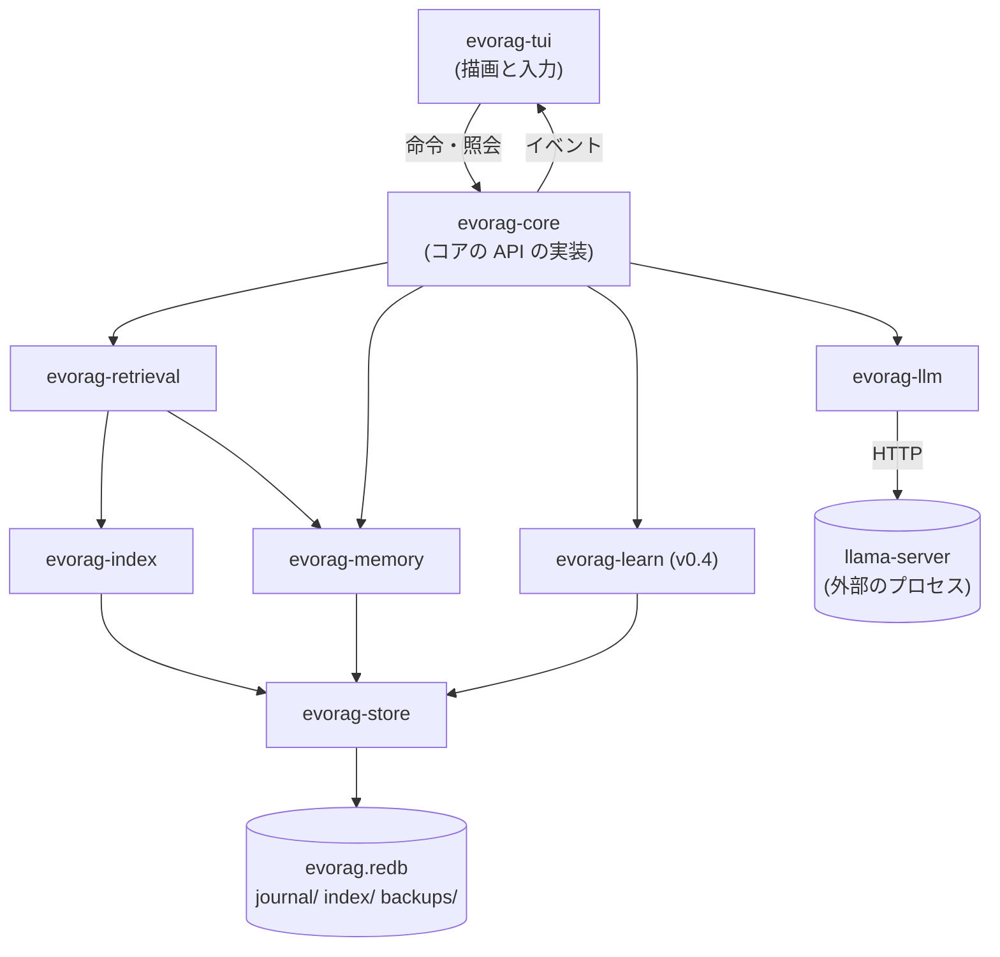

# 02. アーキテクチャ (Architecture)

| 項目 | 内容 |
|---|---|
| 文書ID | 02-architecture |
| 状態 | ドラフト |
| 前提 | [00-overview](00-overview.md) / [01-requirements](01-requirements.md) |
| 正本の概念 | プロセスの構成、コアの API (命令・イベント・照会)、crate の構成と依存の規則、スレッドとタスク、決定性のための注入、エラーとログ、脅威モデル |
| 主対象 crate | 全体 |

---

## 1. プロセス

- `evorag` を起動すると、TUI とコアが **1 つのプロセス** で動く。TUI を閉じるとコアも止まる (提案、[ADR-0003](10-decisions.md#adr-0003-tui-とコアを-1-つのプロセスで動かす))。
- 1 つのデータ根を使えるプロセスは 1 つだけ (03 §9)。サブコマンドも同じロックを取る。
- 常駐 (daemon) とエディタ連携専用のモードは作らない (v1.0 の前に採否を決める、OQ-25)。後で分けるときは、§3 のコアの API をそのままプロセスの外へ出す。

## 2. 全体図

## 3. コアの API

画面の種類に依存しないように、コアと画面の間を次の 3 つで切る。型はすべて `evorag-types` に置く。

| 区分 | 向き | 中身 (例) |
|---|---|---|
| **命令** (Command) | 画面 → コア | 発話する、中断する、再生成する、セッションを開く・作る・改名する・消す、評価する、事実を忘れる・private にする、出典の範囲を変える、モデルを切り替える、precept を承認する・巻き戻す |
| **イベント** (Event) | コア → 画面 | トークンの断片、応答の完了・中断・失敗、添えたメモリ (とカートリッジ) の出典、裏の処理の状態、学習の提案と採用、警告とエラー、接続の状態 |
| **照会** (Query) | 画面 → コア → 画面 | セッションの一覧、セッションのターン、事実の一覧、出典の詳細、precept の履歴、点検の結果。読み取り用の型だけを返す |

**決めごと**:
1. コアは表示用の文字列を作らない。利用者に見せる文言は文言キーと引数 (`MessageKey` と値) で返し、画面が訳す (07 §6)。
2. 画面に依存する整形 (色・折り返し・キー操作) は、すべて画面の側で行う。TUI 専用の機能をコアに置かない。
3. 命令は型付きの enum で、追加だけで広げる (既存の値の意味を変えない)。イベントと照会の型も同じ。
4. イベントは順序を保つ 1 本の流れ (チャネル) で届く。画面は購読して描画するだけにする。
5. **契約の固定**: v0.1〜v0.6 の間、コアの API は同じプロセスの中だけで使うので、版の間で変えてよい (`evorag-types` は crates.io に公開しない)。プロセスの外へ出すときに「契約の版 1」として固定し、以後は足すだけにする (確定、[OQ-25](10-decisions.md#oq-25-コアの-api-の契約を固める時期))。

## 4. crate の構成

### 4.1 一覧

| crate | 役割 | 主な依存 | 入る版 |
|---|---|---|---|
| `evorag-types` | ID、時刻、エラー、文言キー、コアの API の命令・イベント・照会の型 | serde | v0.1 |
| `evorag-llm` | llama-server のクライアント (chat・embed・rerank・tokenize・props・slots) | reqwest (TLS なし)、serde_json、schemars | v0.1 |
| `evorag-store` | redb の表、封筒、スキーマの版と移行、書き手スレッド、`WriteToken`、ジャーナル、退避、ロック | redb、ciborium、xxhash-rust | v0.1 |
| `evorag-index` | 語彙の索引とベクトルの索引、セグメントの形式と入れ替え | memmap2、rayon、arc-swap | v0.1 (語彙) / v0.2 (ベクトル) |
| `evorag-memory` | メモリの書き込み・統合・読み出し、事実の入口、訂正の検証 | — | v0.1 (ターンとセッション) / v0.2〜v0.3 |
| `evorag-retrieval` | 問いの準備、候補の収集と順位付け、文脈の組み立て | unicode-normalization | v0.1 |
| `evorag-learn` | 回帰台帳、precept、提案、リプレイ、ゲート | — | v0.4 |
| `evorag-cartridge` | カートリッジの形式・検証・導入・作成 | zip (圧縮なしの読み書きだけ、既定の機能を切る)、minisign-verify、encoding_rs | v0.5 |
| `evorag-update` | 本体の更新の確認・取得・検証・適用 | HTTP のクライアント + rustls + rustls-graviola (純 Rust の暗号の実装、OQ-05)、minisign-verify | v0.3 |
| `evorag-core` | 上を組み立てるコア。コアの API の実装、sleep-time の進行 | tokio、tracing | v0.1 |
| `evorag-tui` | TUI | ratatui、crossterm、unicode-width、unicode-segmentation | v0.1 |
| `evorag` (bin) | サブコマンドの入口 | clap | v0.1 |
| `xtask` (bin、`publish = false`) | 開発用の作業コマンド (check、check-deps、i18n、trace、live-llm) | — | v0.1 |

### 4.2 依存の方向

- 依存は一方向だけ。下の表の上の行の crate は、下の行の crate に依存しない。

| 層 | crate |
|---|---|
| 入口 | `evorag` (bin) |
| 画面 | `evorag-tui` |
| 組み立て | `evorag-core` |
| 機能 | `evorag-retrieval`、`evorag-learn`、`evorag-cartridge`、`evorag-update` |
| 部品 | `evorag-memory`、`evorag-index`、`evorag-llm` |
| 保存 | `evorag-store` |
| 型 | `evorag-types` |

### 4.3 依存の規則 (`deps-policy.toml` で検査する)

| 規則 | 内容 |
|---|---|
| R1 | `evorag-tui` は `evorag-types` と `evorag-core` の公開 API だけを使う |
| R2 | redb を直接使ってよいのは `evorag-store` だけ。他の crate は `evorag-store` の trait (記録の読み書き、関係、副索引、範囲の走査) を使う |
| R3 | HTTP のクライアントを使ってよいのは `evorag-llm` と `evorag-update` だけ。`evorag-llm` は TLS を持たない |
| R4 | `evorag-types` の外部依存は serde だけ |
| R5 | C を含む依存は 0。例外は作らない。TLS を使ってよいのは `evorag-update` だけで、暗号の実装は純 Rust のもの (OQ-05) に限る。ring・aws-lc-rs・OpenSSL を依存の木に入れない |
| R6 | 画面を扱う crate (ratatui、crossterm) を使ってよいのは `evorag-tui` だけ |
| R7 | スレッドを作ってよいのは `evorag-core` (書き手スレッドと tokio の実行器) と `evorag-tui` (入力) だけ。重い計算は rayon の pool を使う |

## 5. スレッドとタスク

| 担当 | 中身 | 実行方式 |
|---|---|---|
| 画面 (TUI) | 描画と入力 | 専用のスレッド |
| チャット経路 | 発話の確定の依頼、文脈の組み立て、検索、生成の受信 | tokio のタスク |
| 書き手 | `evorag.redb` とジャーナルへの書き込み (会話の追記と、裏の処理の結果) | 専用のスレッド 1 本 |
| sleep-time | メモリの統合、索引の作り直し、退避、学習 | tokio のタスク 1 本 (LLM の呼び出しは直列) |
| 決定論的な重い計算 | 索引の構築、ベクトルの量子化 | rayon |

- **書き込みの入口は 1 つ**: 書き込み用の `WriteToken` は書き手スレッドだけが持つ。チャット経路と sleep-time は、書き込みの依頼 (型付きのメッセージ) を書き手スレッドに送り、結果を待つ。応答の経路に渡すのは読み取り用の型だけ。
- **優先度**: 書き手スレッドは、会話の追記の依頼を裏の処理の結果より先に処理する (2 本の待ち行列)。
- **終了**: 終了の合図 (TUI を閉じる、Ctrl+C、Windows のコンソールを閉じる (猶予は約 5 秒)、SIGTERM) を受けたら、新しい依頼を止め、書き手スレッドの待ち行列にある会話の追記を書き切ってから終わる。裏の処理の結果は捨ててよい (job から再開できる)。

## 6. 決定性のための注入

- 時刻は `Clock` の trait、ID の生成は `IdGen` の trait で注入する。試験では固定の時計と種を固定した生成器を使う。
- llama-server は `LlmClient` の trait の後ろに置き、試験では記録した応答を再生する実装を使う (09 §3.3)。
- ファイルシステムの障害 (書き込みの失敗・空きの不足・強制終了) は、`evorag-store` の下の層で注入できるようにする (09 §4)。

## 7. エラーとログ

- エラーは crate ごとの型 (`thiserror`) で持ち、コアの API では「文言キー + 分類 (利用者の操作で直る / 設定 / 接続 / データ / 内部)」で返す。
- 利用者に見せるエラーは、何が起きたか・データは無事か・次に何をすればよいかを含む (NFR-604)。
- ログは `tracing` で、状態のフォルダ (03 §2) の `logs/` に書く。ログの文言は英語。
  - 応答ごとに短い追跡 ID を付ける。
  - 判定点の結果 (Fire / Abstain / Skip) を記録する。
  - **会話の本文・事実の値・precept の本文・API キーを出さない**。出すのは ID・長さ・件数・時間だけ (NFR-502)。
  - ログは 7 日分だけ残し、古いものから消す。

## 8. 脅威モデル

### 8.1 前提

- **1 人で使う PC** を前提にする。同じ PC の他の利用者アカウントは信頼しない。管理者権限を持つ攻撃者は対象外。
- llama-server は利用者が自分で起動したもので、既定では同じ PC のループバックで動く。

### 8.2 守るもの

| 守るもの | 脅威 | 対策 | 版 |
|---|---|---|---|
| 会話の本文 | 他の利用者アカウントからの読み取り | データ根・設定・書き出しを所有者だけの権限で作る (NFR-503) | v0.1 |
| 会話の本文 | llama-server のふりをする別のプロセスへの送信 (llama-server が止まっている間にポートを取られる) | 起動時に `/props` のモデルのパスと model_key を前回と照合し、違えば知らせる。setup は `--host 127.0.0.1` と `--api-key` を付けた起動例を示す | v0.1 |
| 会話の本文 | 外部への送信 | 既定ではループバック以外を拒否する。外部の接続先は設定で明示し、`https` を必須にする (確定、[OQ-23](10-decisions.md#oq-23-ループバック以外の-llama-server-を許すか)) | v0.1 |
| API キー | 漏洩 | 所有者だけが読める `config.toml` に置き、ログと書き出しから除く | v0.1 |
| 応答の振る舞い | 以前の会話・事実・カートリッジに埋め込まれた指示 (指示の混入) | 信頼しない引用の枠と、要求ごとに変わる区切り (05 §4.2)。事実は利用者の発話だけから抽出し、属性を一覧の内側に限り、値の長さに上限を置く (04 §5)。カートリッジは信頼しない引用の枠だけに入れる | v0.1 / v0.3 / v0.5 |
| システムプロンプト | precept を経由した注入・安全の劣化 | 安全に関わる指示は固定し、自動の編集の対象外にする。precept に決定論の検査 (URL、他の指示の打ち消し、固定の指示への言及を禁止) を通す。採用の前に利用者の承認を得る (確定 (ユーザー回答)、OQ-10)。同梱の安全の回帰事例を必ず流す | v0.4 |
| 本体 | 改ざんした配布物・古い版への巻き戻し攻撃 | 版・対象・ハッシュを含む署名つきのマニフェストを検証する。今より古い版は、巻き戻しを明示したとき以外は拒否する (12 §7) | v0.3 |
| データ根 | カートリッジの展開でのパスの抜け (zip slip) | 危ないパスを拒否し、一時フォルダで検証してから移す (14 §3) | v0.5 |

### 8.3 約束しないこと (文言で正直に伝える)

- 保存時の暗号化はしない (OS のディスクの暗号化を勧める)。暗号化消去は v1.0 の前に検討する (OQ-27)。
- 「忘れる」「削除」が消すのは、evorag が管理するファイルの中だけ。SSD の物理的な消去、OS のバックアップ (ファイル履歴、Time Machine)、利用者が書き出したファイル、llama-server のログとキャッシュは保証の外 (04 §7)。
