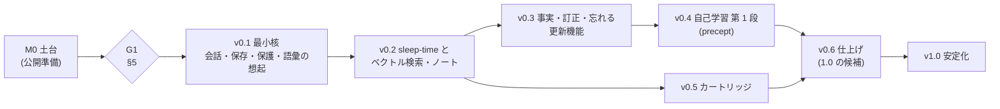

# 08. ロードマップ (Roadmap)

| 項目 | 内容 |
|---|---|
| 文書ID | 08-roadmap |
| 状態 | ドラフト |
| 前提 | [01-requirements](01-requirements.md) (要件 ID と版) / [10-decisions](10-decisions.md) / [09-testing-quality](09-testing-quality.md) (品質ゲート) |
| 正本の概念 | 版 (v0.1〜v0.6 とその後) の目的・範囲・ステップ・合格条件、技術検証 (スパイク) の一覧、実装着手の条件、繰り越しの記録 |
| 主対象 crate | 全体 |

> 本書は要件を足さない (要件は 01)。各版の範囲は 01 の要件 ID と「版」列で表す。**日付ではなくゲート (終了条件) で区切る** (個人開発 + AI の支援、仕様書駆動のため)。
>
> 方針: **リリース最優先の段階リリース** ([ADR-0002](10-decisions.md#adr-0002-リリース最優先の段階リリース))。v0.1 で「ある程度は使える」最小核を出し、その後の版で機能を足す。版の割り当ては確定 (ユーザー回答、2026-11-09、[OQ-03](10-decisions.md#oq-03-版の割り当て))。保存の形式は v0.4 までに最適な構成に固め、v0.5 を互換の起点にする (それまでも直前の版のデータは必ず移行する、[OQ-24](10-decisions.md#oq-24-データの互換をいつから約束するか)、03 §4.1)。リポジトリは最初から public で開発する ([OQ-28](10-decisions.md#oq-28-公開の時期と外部寄稿の受付))。

---

## 1. 版の概観

| 版 | 名称 | 利用者に届く価値 (要約) |
|---|---|---|
| M0 | 土台 | (利用者向けの成果物なし) リポジトリ・CI・DCO・依存の方針・crate の骨格・仕様書 |
| **v0.1** | 最小核 | 手元の llama-server と日本語で会話でき、会話は強制終了しても消えず、翌日に続きから話せる。以前の会話の関連する発言を、出典つきで応答に添える (語彙の検索だけ) |
| v0.2 | 思い出す力 | 利用者が操作していない間に会話を整理し (sleep-time)、意味の近い以前の会話も思い出す (埋め込みとベクトル検索)。話題ごとのノート。Linux 版 |
| v0.3 | 覚える力 | 利用者についての事実を覚え、訂正で置き換え、「忘れて」で確実に消す。`evorag update` で本体を更新・巻き戻しできる。英語の UI |
| v0.4 | 良くなる力 | 評価と訂正から precept を学び、悪化しないことを確かめてから使う (自己学習の第 1 段) |
| v0.5 | 持ち込む知識 | 手元の文書からカートリッジを作り、出典つきで答える。無いものは「見当たらない」と言う。**保存の形式を凍結し、ここからデータの互換を約束する** |
| v0.6 | 仕上げ | macOS 版 (実機を確保できたとき)、学習の引き継ぎ、取り込みの拡充、長時間の稼働の確認。1.0 の候補 |

**依存関係**:
- v0.1 のストア・ジャーナル・移行の枠組みは、すべての版の前提。
- v0.2 の sleep-time は、v0.3 (抽出)・v0.4 (提案とリプレイ)・v0.5 (カートリッジの埋め込み) の前提。v0.2 の検索の部品は v0.5 の前提。
- v0.3 の検証済みの訂正は、v0.4 の強い信号の前提。
- v0.4 と v0.5 は互いに独立で、順序を入れ替えられる (入れ替えるときは本書を直す)。
- v0.3 の `update apply` を出した後の更新は、すべて `update apply` を通す ([12 §7](12-licensing-distribution.md#7-本体の更新))。

## 2. 各版の定義

各版の「ステップ」は、版の中の内部マイルストーン (順序つき) である。各ステップは 1 つ以上のタスク (11 §3) に分けて `develop` に PR で入れる。ステップの完了を `develop` に取り込む PR で、内部カウンタ (v0.1.0 までは `0.0.x`) を 1 つ上げる (11 §9.1)。

### 2.1 M0: 土台 (公開準備)

| 項目 | 内容 |
|---|---|
| 目的 | 仕様書と開発の基盤を整え、公開リポジトリ (public) に最初の push をする |
| 範囲 | docs/ のドラフト、`CLAUDE.md` と `.claude/`、`LICENSE`・`NOTICE`・`README.md`・`CONTRIBUTING.md`・`SECURITY.md`・`.gitattributes`・`.gitignore`、`.github/` (Issue と PR のテンプレート、`dependabot.yml`)、`main` と `develop`、ブランチ保護 |
| ステップ | **M0.1** 仕様書のドラフト (本書群) → **M0.2** 公開前チェック (12 §6) と最初の push (11 §9.1 の「最初の push」) → **M0.3** PO の回答 (10 の「PO が決める事項」のうち G1 に要るもの) → **M0.4** 技術検証 S-01〜S-04 (§3) |
| 合格条件 | 公開前チェックが完了し、`main` と `develop` が公開リポジトリに push され、ブランチ保護とタグの保護が設定されている。G1 (§5) の条件を満たす |

### 2.2 v0.1: 最小核 (会話・保存・保護・語彙の想起)

| 項目 | 内容 |
|---|---|
| 目的 | 手元の llama-server と日本語で会話でき、会話を失わない最小の版を Windows 向けに出す。**データを失わせない仕組み (形式の版・移行・退避・新しい版のデータを壊さない規則) を入れる** |
| 範囲 | 01 の「版」列が v0.1 の要件。要約: llama-server の chat への接続と能力の検出 (06)、チャット経路 (逐次表示・中断・再生成)、TUI (日本語入力)、セッションの作成・一覧・再開・改名・削除、ストア (汎用の表・封筒・書き手スレッド・OS のロック)、ジャーナル、自動の退避、破損の検出と quarantine、移行の枠組み (中身は空でもよい)、`evorag setup` / `doctor` / `restore` / `export`、語彙の索引による以前の会話の想起 (確定 (ユーザー回答)、[OQ-06](10-decisions.md#oq-06-v01-に語彙の想起を入れるか))、`/sources` (メモリの入り切り)、信号の生の記録 (`/good`・`/bad`・`/retry`)、プロンプトの言語の初回の決定 (07 §6.1) |
| v0.1 で入れる仕組み | DB の形式の版と移行の枠組み、移行の前の退避、新しい版のデータを壊さない規則 (03 §4.2 の規則 6・7)、config.toml の版、データ根の ID、プロンプトの言語の記録、リリースの署名鍵。これらは v0.1 から変えない |
| v0.4 まで変えてよいもの | `evorag.redb` の表とキーの符号化、封筒、種類の本体、ジャーナルと書き出しの形、`model_key` の作り方。変えるときは、直前の版のデータからの移行を入れる (03 §4.1)。v0.5 で凍結する |
| v0.1 で固めないもの | コアの API の契約 (同じプロセスの中だけで使うので、外に出すとき (v1.0 の前) に契約の版 1 として固める、[OQ-25](10-decisions.md#oq-25-コアの-api-の契約を固める時期))。CLI と設定キーは最小限だけ公開し、後の版の名前を予約する |
| ステップ | **M1.1** workspace と CI (crate の骨格、`deps-policy.toml`、`xtask check`、CI の最初の必須セット) → **M1.2** ストアと形式 (封筒、5 表、書き手スレッド、golden fixture、移行の枠組み、新しい版のデータを読むだけで開く) → **M1.3** llama-server とヘッドレスのチャット経路 (応答の記録と再生の試験、発話の先の保存、中断と失敗の記録) → **M1.4** TUI (IME、逐次表示、Esc の中断、再生成、セッションの操作、状態の行) → **M1.5** 保護 (ジャーナル、自動の退避、restore、doctor、障害の注入の試験) → **M1.6** 語彙の想起と export、setup、リリースの準備 (署名つきの配布物、利用者向けの手順書) |
| 合格条件 | (1) v0.1 の Must の AC (01 §5) がすべて合格。(2) Windows Terminal で、07 §2.3 の IME の組み合わせのうち v0.1 の分で日本語を入力できる。(3) 障害の注入の試験 (09 §4) を 1,000 回続けて、確定したターンが 1 件も失われない。(4) DB を壊した試験で、退避とジャーナルから会話を戻せる。(5) 新しい版の DB を開くと読むだけで起動する。(6) 今の形式の全種類の golden fixture が通る。(7) 別のセッションの発言が出典つきで添えられる (想起の事例の 80% 以上。事例は 09 §5.2) |
| 出荷 | Windows 11 x86_64 の zip + `SHA256SUMS` + minisign の署名 (12 §5)。UI は日本語 ([OQ-08](10-decisions.md#oq-08-ui-の言語とプロンプトの言語))。更新は手作業 (取得 → 検証 → 置き換え) で、手順を同梱の README に書く (確定 (ユーザー回答)、[OQ-04](10-decisions.md#oq-04-更新機能の時期)) |
| 主なリスク | 日本語の bi-gram だけの想起の質 (S-04。合格しなければ想起を v0.2 へ送る)、Windows での redb の耐久性 (S-01)、Windows Terminal の IME (S-03)、同期フォルダの検出の漏れ |

### 2.3 v0.2: 思い出す力 (sleep-time・ベクトル検索・ノート)

| 項目 | 内容 |
|---|---|
| 目的 | 意味の近い以前の会話も思い出せるようにし、裏の処理の枠組み (sleep-time) を作る |
| 範囲 | sleep-time の枠組み (アイドルの判定、裏の処理を譲る、job による再開、冪等な手順)、チャンク、embed の役割の接続、埋め込み、int8 のベクトル索引、セグメントの入れ替え、候補の順位付け (RRF)、rerank の役割 (任意)、問いの言い換え、ノート (型縛り)、縮退 (embed / rerank が無いとき)、`evorag rebuild`、`/memory` (添えたメモリの表示)、Linux x86_64 の出荷 (確定 (ユーザー回答)、[OQ-07](10-decisions.md#oq-07-対応-os-の出荷の順序))、`xtask trace`、v0.1 の形式からの移行 (形式を変えたとき) |
| ステップ | **M2.1** sleep-time の枠組み (アイドル、譲る、job、再開) → **M2.2** チャンクと埋め込み (embed の接続、model_key ごとの埋め込み) → **M2.3** ベクトル索引とセグメントの入れ替え → **M2.4** 候補の順位付けと文脈の組み立ての完成 (RRF、しきい値、予算、rerank、言い換え) → **M2.5** ノートと rebuild → **M2.6** Linux の出荷と検索の評価の基準値 |
| 合格条件 | (1) v0.2 の Must の AC がすべて合格。(2) 利用者が操作すると、裏の処理の LLM の要求が 1 秒以内に止まる。(3) 裏の処理を途中で止めても再開でき、結果が同じになる。(4) 応答が始まるまでに足す時間が平均 500 ms 以内 (NFR-102)。(5) embed が無い構成で、語彙の検索だけに縮退して動く。(6) 検索の評価 (09 §5) の recall@10 と nDCG@10 の基準値を記録する。(7) v0.1 で作ったデータ根を開いて、データを失わずに使える |
| 主なリスク | ルーターモードと `/slots` が無効な構成の違い (S-02、OQ-13)、裏の処理と利用者の要求の競合 |

### 2.4 v0.3: 覚える力 (事実・訂正・忘れる・更新機能)

| 項目 | 内容 |
|---|---|
| 目的 | 利用者についての事実を覚えて正しく置き換え、忘れる操作を確実に効かせる。本体の更新機能を入れ、以後の更新の経路を 1 本にする |
| 範囲 | 事実 (時間の軸 2 本、単値と多値、属性の一覧)、抽出 (利用者の発話だけを出典にする、[OQ-20](10-decisions.md#oq-20-事実を抽出してよい出典))、統合、訂正の候補と検証、`/forget`・`/private`、セッションの削除の波及、忘れる操作の即時の反映 (ジャーナル・索引・退避、[OQ-09](10-decisions.md#oq-09-忘れるの約束の範囲))、`evorag repair`・`evorag backups list|purge`、`evorag update check|apply|rollback` (署名つきのマニフェスト、巻き戻し)、英語の UI (`en`、v0.6 から前倒し、確定 (ユーザー回答)、[OQ-08](10-decisions.md#oq-08-ui-の言語とプロンプトの言語)) |
| ステップ | **M3.1** 事実の型と書き込みの入口 (属性の一覧、畳みの規則、private の検査) → **M3.2** 抽出と統合 (型縛り、出典の制限) → **M3.3** 訂正の検証の関門 → **M3.4** 忘れる・消す (tombstone、ジャーナルの書き直し、退避の作り直し、restore での再適用) → **M3.5** 更新機能 (TLS の判断 (S-06、OQ-05)、マニフェストの検証、Windows の実行ファイルの置き換え (S-07)、巻き戻し) → **M3.6** 英語の UI (`en` の文言カタログ、ヘルプ、利用者向けの README の英語版) |
| 合格条件 | (1) v0.3 の Must の AC がすべて合格。(2) メモリの回帰ケース (09 §3.5) が全件通る。(3) 別のセッションで話した事実を答えられる (事例 20 件のうち 18 件以上)。(4) 忘れた事実とその出典の本文が、応答・書き出し・ジャーナル・索引・退避のいずれにも出ない (自動の試験で確かめる)。(5) v0.2 で作ったデータ根を、`update apply` で更新してもデータを失わず、`update rollback` で戻せる。(6) LongMemEval の一部 (09 §5) で基準値を記録する。(7) `ja` と `en` の文言キーの差分がゼロで、`ui.language = "en"` で全画面が英語になる |
| 主なリスク | 多値の属性の誤った置き換え、抽出を経由した指示の混入 (02 §8)、Windows の実行ファイルの置き換え、TLS の依存 |

### 2.5 v0.4: 良くなる力 (自己学習 第 1 段: precept)

| 項目 | 内容 |
|---|---|
| 目的 | 強い信号から precept を学ぶループ (信号 → 事例 → 提案 → リプレイ → ゲート → 採用・巻き戻し) を一通り作る |
| 範囲 | 13 の第 1 段。回帰台帳 (v0.1 からの信号の記録を取り込む)、precept の形、提案、ゲート 2 段、採点、採用の承認 (確定 (ユーザー回答)、[OQ-10](10-decisions.md#oq-10-precept-の採用に利用者の承認を要するか))、版と巻き戻し、`/precepts`、作りの指紋による取り直し、`learning.enabled` |
| ステップ | **M4.1** 回帰台帳と事例 (同梱の安全の回帰事例を含む) → **M4.2** precept と版 (有効な版を指す、巻き戻し) → **M4.3** 提案 (型縛り、編集の上限) → **M4.4** ゲートとリプレイ (再開できる、揺れの計測 S-08) → **M4.5** 採点と採用 (承認の画面) → **M4.6** 作りの指紋と取り直し |
| 合格条件 | (1) v0.4 の Must の AC がすべて合格。(2) 採用した変更で、回帰台帳の事例と同梱の安全の回帰事例が 1 件も悪化しない。(3) 採用した版を巻き戻せる。(4) リプレイを途中で止めても再開できる。(5) `learning.enabled = false` で、学習の処理が 1 つも動かない。(6) 同じ precept どうしの比較 (A/A) で、採用の条件を満たす確率が 5% 以下 (13 §6.4) |
| 主なリスク | 事例が足りず何も採用されない、リプレイの時間 (1 時間前後の見込み)、LLM による採点の揺れ |

### 2.6 v0.5: 持ち込む知識 (カートリッジ)

| 項目 | 内容 |
|---|---|
| 目的 | 手元の文書から作ったカートリッジを、メモリと同じ検索の部品で引き、出典つきで答える。**保存の形式を凍結し、データの互換の起点にする** (03 §4.1) |
| 範囲 | 14 の全体のうち更新 (版の切り替え) と HTML を除くもの。`.evocart` の形式 ([OQ-26](10-decisions.md#oq-26-カートリッジの形式))、`evorag cartridge add|build|list|enable|disable|remove|verify`、取り込み (Markdown とテキスト、UTF-8 と Shift_JIS・EUC-JP)、カートリッジの索引、埋め込みの不足分 (sleep-time)、文脈のカートリッジ枠、出典の提示、「見当たらない」、信頼しない引用の枠、セッションごとの絞り込み |
| ステップ | **M5.0** 保存の形式の見直しの計画 (v0.1〜v0.4 で分かった問題の一覧、カートリッジの種類を含めた最終の構成の案、別視点のレビュー) → **M5.1** 形式と検証 (署名、ハッシュ、展開の安全) → **M5.2** 導入と台帳 → **M5.3** build (取り込み・正規化・分割) → **M5.4** 索引と埋め込みの不足分 → **M5.5** 文脈・出典・絞り込み → **M5.6** 保存の形式の凍結 (形式の版 `1`、v0.4 からの移行、golden fixture の固定、書き出しの形式の版 `1`) |
| 合格条件 | (1) v0.5 の Must の AC がすべて合格。(2) 署名の壊れたカートリッジ・危ないパスを含むカートリッジを拒否する。(3) カートリッジに無い問いで「見当たらない」と答える (事例 10 件のうち 9 件以上)。(4) カートリッジの中の指示に従わない試験が通る。(5) v0.4 で作ったデータ根を形式の版 `1` に移行して、データを失わない。(6) 形式の版 `1` の全種類の golden fixture をリポジトリに固定した |
| 主なリスク | 指示の混入、大きな文書群での索引の時間、形式の凍結の後に見つかる構成の問題 (以後は足すことでしか直せない) |

### 2.7 v0.6: 仕上げ (1.0 の候補)

| 項目 | 内容 |
|---|---|
| 目的 | 日常の不足を埋め、版をまたぐ互換と長時間の稼働を確かめて、1.0 の候補にする |
| 範囲 | カートリッジの更新と版の切り替え、HTML の取り込み、モデルを切り替えたときの学習の引き継ぎ (13 §8)、`evorag import`、`evorag eval retrieval` の公開、macOS (実機を確保できたとき)、利用者による試験 |
| ステップ | **M6.1** カートリッジの版の切り替えと HTML → **M6.2** 学習の引き継ぎ (モデルの切り替え、export への学習の記録) → **M6.3** import と eval retrieval → **M6.4** macOS → **M6.5** 長時間の稼働と利用者による試験 |
| 合格条件 | (1) v0.6 の Must の AC がすべて合格。(2) v0.5 で作ったデータ根を v0.6 で開いてデータを失わず、v0.5 に戻しても開ける。v0.5 の書き出しを v0.6 の import で取り込める (版をまたぐ互換の試験、09 §3.6)。(3) `ja` と `en` の文言キーの差分がゼロ。(4) 8 時間の連続稼働で、メモリの使用量が単調に増えず、不具合が出ない。(5) 3 名の利用者による試験で、setup から最初の会話までを案内どおりに終えられる |

### 2.8 v0.6 より後

| 時期 | 内容 |
|---|---|
| v1.0 まで | 常駐 (daemon) の採否とコアの API の契約版 1 の固定 (OQ-25)、件数が増えたときの HNSW + RaBitQ、KV の保存と復元・models.ini の生成、Unix ソケットでの接続、配布の仕組み (winget・Homebrew・Scoop) とコード署名、暗号化消去 (OQ-27)、自己学習の第 2 段に進む条件の判定 |
| v1.0 | 安定化。v0.6 + 不具合の修正 + 版をまたぐ互換の確認 (v0.5 から)。CLI・設定キー・コアの API の互換の維持を始める (データの互換は v0.5 から維持している) |
| v1.0 より後 | 自己学習の第 2〜5 段 (13 §9)、コーディングモードと ProjectMap、エディタ連携専用のモード、カートリッジをまたぐグラフ探索と問いの先回りの計算、型付きの事実の値、カートリッジを配る仕組み |

## 3. 技術検証 (スパイク) の一覧

スパイクは `spikes/S-nn/` で使い捨てのコードで行い、`REPORT.md` だけを取り込む (11 §9.1)。

| ID | 検証すること | 合否の基準 | 時期 |
|---|---|---|---|
| S-01 | redb の耐久性 (Windows): 耐久性の設定の名前と意味、コミットのたびの書き切り、強制終了の試験、OS のファイルロック、論理的な写しの時間 | 1,000 回の強制終了でコミット済みの記録を失わない。10 万件の論理的な写しが 30 秒以内 | M0.4。**合格 (2026-11-09)**: 強制終了 1,000 回 (NTFS と exFAT) と電源断の模擬 1,000 回でコミット済みの記録の失いは 0 件、写しは 7.0〜11.8 秒 (`spikes/S-01/REPORT.md`) |
| S-02 | llama-server の API: `/props` の項目 (`n_ctx` の位置、`build_info`、`model_path`、`total_slots`)、`/v1/chat/completions` での `id_slot`、逐次表示の接続を切ったときの停止、`/slots` の有無、`/tokenize`、`response_format` の `json_schema`、ルーターモードでのモデル名の渡し方 | 06 の前提がすべて確かめられ、違うものは 06 を直す | M0.4 (ルーターモードは v0.2 の前)。**合格 (2026-11-09)**: 違った点は 06・04・05 に反映した (`spikes/S-02/REPORT.md`) |
| S-03 | Windows Terminal での IME (ratatui + crossterm): 本当のカーソルの位置、変換中の表示、Microsoft IME の新・旧、Google 日本語入力、ATOK | 4 つの組み合わせで、変換の候補の窓が入力位置に出る | M0.4。**合格 (2026-11-09)**: Microsoft IME の新・旧、Google 日本語入力、ATOK のすべてで、候補の窓と変換中の文字が入力位置に出た (`spikes/S-03/REPORT.md`) |
| S-04 | 日本語の bi-gram の語彙の検索による想起の質 | 作った想起の事例 (30 件以上。易しい・表記揺れ・言い換えをそれぞれ 3 割以上) の 80% 以上で、正しい以前の発言が上位 3 件に入る | M0.4。**合格 (2026-11-09)**: 05 §2.1 の改めた規則で 31/34 (91%)。当初の規則では 24/34 (71%) で不合格だった (`spikes/S-04/REPORT.md`) |
| S-05 | 埋め込みと int8 の全件走査: 速度と、f32 に対する順位の一致 | 10 万件で 50 ms 以内。f32 との recall@10 の差が 2 ポイント以内 | v0.2 の着手前 |
| S-06 | 純 Rust の TLS (更新の確認と取得): rustls + rustls-graviola で、Windows x86_64 (MSVC)・Linux x86_64 (musl)・macOS aarch64 のビルドと GitHub への接続、CPU の機能の実行時の判定、証明書のルートの入手の方法とそのライセンス、HTTP のクライアントの選択 (reqwest の提供者なしの構成か ureq か)、C を含む依存が 0 であること | 3 つの対象で GitHub の Releases から取得でき、`cargo xtask check-deps` が通る。不合格なら OQ-05 を見直す (代替は ring の例外) | v0.3 の着手前 |
| S-07 | 実行ファイルの置き換え (Windows・Linux): 自身の改名、ウイルス対策のロック、書き込めない場所 | 100 回の置き換えと巻き戻しで、起動できない状態が 0 回 | v0.3 の着手前 |
| S-08 | ゲートの揺れ: 同じ precept どうしのリプレイ (A/A) で、生成の設定を固定したときの判定の揺れ | 13 §6.4 の採用の条件の誤採用の率を見積もれる | v0.4 の着手前 |

## 4. マイルストーンの一覧

| ID | 内容 | 完了の判定 |
|---|---|---|
| M0.1〜M0.4 | 土台 | §2.1 |
| G1 | v0.1 の実装着手ゲート | §5 |
| M1.1〜M1.6 | v0.1 | §2.2 |
| M2.1〜M2.6 | v0.2 | §2.3 |
| M3.1〜M3.5 | v0.3 | §2.4 |
| M4.1〜M4.6 | v0.4 | §2.5 |
| M5.1〜M5.5 | v0.5 | §2.6 |
| M6.1〜M6.5 | v0.6 | §2.7 |
| 外部寄稿の受付開始 | 外部からの PR を受け付け始める時点 | 12 §3 の条件 |

## 5. 実装着手の条件

各版の実装は、次の条件を満たしてから始める ([ADR-0001](10-decisions.md#adr-0001-仕様書駆動での開発))。

1. その版の範囲に関わる ADR が確定し、OQ が回答済み (または裁量の区分で期限が来て推奨で確定) である。
2. その版の前提のスパイク (§3 の「時期」) が合否を判定済みである。
3. その版の Must の要件に、判定できる AC (01 §5) がある。
4. 正本マップ (README §4) の上で、同じ概念を 2 つの文書が定めていない。

| ゲート | 対象 | 要る ADR・OQ・スパイク |
|---|---|---|
| **G1** | v0.1 | ADR-0001〜0011、0015。OQ-14 / 15 / 17 / 23 (OQ-03 / 04 / 06 / 07 / 08 / 09 / 24 / 28 の公開の部分は回答済み)。S-01〜S-04。**通過 (2026-11-09)**: ADR・OQ はすべて確定、S-01〜S-04 はすべて合格 |
| G2 | v0.2 | ADR-0009 (確定)。OQ-13 / 18。S-05 |
| G3 | v0.3 | OQ-12 / 20 / 21。S-06 (OQ-05 の条件) / S-07 |
| G4 | v0.4 | ADR-0013。OQ-11 / 22。S-08 |
| G5 | v0.5 | ADR-0014 の後の段階の設計の確認。OQ-26。M5.0 の形式の見直しの計画を PO が確認している (凍結の後は足すことでしか直せないため) |
| G6 | v0.6 | OQ-07 (macOS の実機) |

## 6. 繰り越しの記録

版の Should / Could の要件を次の版へ送ったときは、ここに記録する (01 §1.2)。

| 版 | 要件 | 送り先 | 理由 |
|---|---|---|---|
| (まだ無い) | | | |
