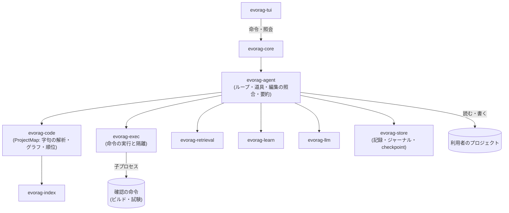

# 15. コーディングモード (Coding)

| 項目 | 内容 |
|---|---|
| 文書ID | 15-coding |
| 状態 | ドラフト (構想。v0.1 のリリースの後に詳細を検討し直す。入れるのは v1.0 より後) |
| 前提 | [02-architecture](02-architecture.md) / [03-storage](03-storage.md) / [05-retrieval](05-retrieval.md) / [06-llm](06-llm.md) / [13-learning](13-learning.md) |
| 正本の概念 | コーディングモードの構成、ProjectMap (コードの索引)、道具と編集の形式、実行の隔離と権限、利用者のファイルの保護、コーディングの自己改善 (13 §9 の第 5 段の中身)、v0.5 の凍結までに予約する拡張点 |
| 主対象 crate | (仮) `evorag-code`、`evorag-agent`、`evorag-exec` |

> コーディングモードは v1.0 より後に入れる ([ADR-0016](10-decisions.md#adr-0016-v10-までコーディングモードを入れない))。本書は、先行するコーディングの道具と研究の設計の考え方を、evorag の原則 (P1〜P8) と ADR に合わせて組み合わせた構想である。他の道具のコードは取り込まない。v1.0 より前に行うのは、§10 の拡張点の予約だけである。PO の判断が要る箇所には「(提案、OQ-<番号>)」を付けた。
>
> **見直しの時期**: 本書は v0.1 の実装より前に書いた初版である。v0.1 のリリースの後に、v0.1 で分かったこと (保存・検索・llama-server との接続の実際) を踏まえて、詳細を検討し直す (PO の指示、2026-11-09)。OQ-30〜33 の推奨も、そのときに見直す。

---

## 1. 位置づけと方針

### 1.1 チャットとの違い

| 観点 | チャット (04・05) | コーディング |
|---|---|---|
| 引く対象 | 以前の会話から作ったチャンク・ノート・事実。意味の近さで引く | プロジェクトのコード。識別子の一致と、定義・参照の構造で引く |
| 古さ | 記憶はゆっくり古くなる | ファイルは数分で変わる。変わったファイルの索引を作り直さないと、古いコードを根拠に答える |
| 1 回の作業 | 1 回の発話に 1 回答える | 読む → 直す → 確かめる → 結果を見て直す、の繰り返し (§5) |
| 正しさの確かめ方 | 機械では判定しにくい | 確認の命令 (ビルド・試験) の結果で判定できる |
| 書き込む先 | evorag のデータ根だけ | 利用者のファイル (§7) |
| 文脈に入れるもの | 少しの記憶と直近の会話 | ファイルの抜粋・差分・エラーの出力。行の位置まで正確に扱う |

### 1.2 方針

1. **文脈は道具の側で決める**。7B〜30B のモデルに自由に探索させると、迷うか、文脈を使い切る。入れる文脈は ProjectMap (§4) で決め、モデルによる探索は補助にする。
2. **モデルの言うことで成否を決めない**。成否は、evorag が自分で実行した確認の命令の結果だけで決める。モデルが「試験が通った」と書いても信じない (§8.1)。
3. **利用者のファイルを失わない**。P1 (会話を失わない) を利用者のファイルにも広げる。書く前に元の内容を残し、戻せるようにする (§7)。
4. **チャットと部品を共有する**。llama-server のクライアント (06)、保存とジャーナル (03)、検索の部品 (RRF・文脈の予算、05)、学習のゲート (13) を共有する。コーディング専用のものは、ProjectMap・道具・実行・編集だけにする。
5. **C を含む依存は 0** ([ADR-0015](10-decisions.md#adr-0015-c-を含む依存は-0-にする)) をコーディングモードでも守る (§4.1)。
6. **外へ通信しない** (P2) を、evorag が起動する命令にも及ぼす (§6.2)。

## 2. 参考にした設計と取り込むもの

| 参考先 | ライセンス | 取り込む考え方 | 取り込まないもの (理由) |
|---|---|---|---|
| Aider | Apache-2.0 | repo map (定義と参照のグラフ、個人化した PageRank、予算に合わせて載せる量を二分探索する)、SEARCH/REPLACE の編集の形式、照合の段と失敗したときの返し方、lint と試験の結果を次の入力に回すループ | tree-sitter (C を含む)、自動のコミットを既定にすること (利用者の履歴を汚す) |
| code-graph-rag | MIT | 言語を問わないグラフのスキーマ (限定名を鍵にする)、辺に呼び出しの箇所と解決の確からしさ (exact / heuristic) を持たせる、ファイルのハッシュで変わったものと依存 1 段だけを作り直す増分の更新、名前だけを引数に取る決まった照会 (callers・callees など)、複数ファイルの編集の取引 (stage → 検証 → 原子的に書く → 外で変わっていたら衝突) | LLM にグラフの照会言語 (Cypher) を書かせること (小さいモデルで壊れやすい。作者も小さいモデル用の厳しいプロンプトに切り替えている)、SQLite・Memgraph (C を含む、または外部の DB)、Python の埋め込みモデル |
| OpenAI Codex CLI | Apache-2.0 | 行番号を使わず文脈の行で位置を探すパッチと、少しずつ緩める照合、サンドボックスの段 (読むだけ / 作業の場所に書ける / 全部)、承認、プロジェクトの指示ファイルを根から順に連結して上限を付けて読む | GPT 系に合わせたプロンプトと長いループ |
| opencode | MIT | 編集の後に診断を道具の結果に付ける、要約の決まった様式 (目的・決定・作業の状態・次の一手・関係するファイル。パスとエラーの文は原文のまま)、古い道具の出力から畳む、計画のエージェント (読むだけ) と作業のエージェントを分ける、権限の規則 (最後に当たった規則が勝つ、合成した命令は分けて判定する) | LSP の常時起動を既定にすること (メモリを llama-server と取り合う) |
| SWE-agent (ACI) | MIT | 道具の画面を LLM 向けに設計する。ファイルは 100 行の窓で見せる、検索の結果の件数に上限を置く、構文を壊す編集を拒む、出力が空のときは明示する、直近の 5 件の観察だけを全文で残す (それぞれの効果が比較の実験で測られている) | — |
| Claude Code (公開の文書にある振る舞いだけ) | — (コードは見ない) | 権限のモードと deny の規則の優先、hook、編集の前の写し (checkpoint) と巻き戻し、計画を承認するまで編集しない mode、サブエージェントで文脈を分ける、プロジェクトの記憶をファイルに置いて利用者が編集できるようにする | — |
| 自己改善の研究 (§8、出典は §12) | — | 成功した手順を検証つきで貯めて引く (Voyager、AWM)、差分だけで育てる playbook と全体を書き直さないこと (ACE)、試験による候補の選択 (CodeT)、試行の中だけの振り返り (Reflexion) | 自分のコードを書き換える自己改善 (DGM、SICA)、重みの学習 ([ADR-0012](10-decisions.md#adr-0012-重みを学習しない)) |

## 3. 全体の構成



- crate の名前と層は仮である。`evorag-agent` は「機能」の層、`evorag-code` と `evorag-exec` は「部品」の層に置く (02 §4.2)。
- 子プロセス (確認の命令、外部の言語サーバ) を起動してよいのは `evorag-exec` だけにする (02 §4.3 に規則を足す。C3 の着手の前)。子プロセスの待ち合わせは tokio のタスクで行い、スレッドを新たに作らない (R7)。
- 自己改善のリプレイ (§8) は作業を流し直すが、`evorag-learn` は `evorag-agent` に依存しない。`evorag-learn` がリプレイの trait を定め、`evorag-agent` がそれを実装し、`evorag-core` が組み合わせる (依存の循環を作らない)。
- OS の隔離の API (§6.2) は、C を含まない束縛 (Windows は `windows-sys`、Unix は `rustix` など) で呼ぶ。

## 4. ProjectMap (コードの索引)

### 4.1 解析の方法 (提案、OQ-30)

Aider と code-graph-rag は tree-sitter で定義と参照を取り出すが、tree-sitter は本体も各言語の文法も C で書かれていて、ADR-0015 に反する。次の組み合わせにする。

| 方式 | 精度 | 依存 | 扱い |
|---|---|---|---|
| A. 内蔵の字句の解析 (言語ごとの字句の規則と、定義の形の規則) | 定義はほぼ取れる。参照は名前の一致 | 純 Rust | **既定** |
| B. 外部の言語サーバ (LSP。rust-analyzer、pyright など) | 高い | 利用者が入れた別のプログラム。リンクしない | 任意。設定したときだけ使う |
| C. 純 Rust の構文解析器 (Rust のコードに限る。候補は `ra_ap_syntax`) | 高い (Rust だけ) | 純 Rust (S-09 で確かめる) | 任意 |
| D. tree-sitter | 高い | C | 採らない (ADR-0015) |

- A を既定にできる理由: repo map の参照は、もともと「識別子の名前の一致」で数えている (Aider)。PageRank は少しの誤りに強い。地図の目的は「どのファイルのどの定義を見せるか」を決めることで、正確な呼び出しの解決ではない。
- A の字句の解析は、文字列・コメント・raw 文字列を正しく飛ばす (飛ばし損ねると、偽の定義と参照が出る)。最初に対応する言語は Rust、Python、TypeScript / JavaScript、Go とする (提案)。対応しない言語のファイルは、語彙の索引 (§4.4) だけに入れる。
- A と D の質の差は技術検証 S-09 で測る。D はスパイクの中で物差しとしてだけ使う。

### 4.2 グラフの形

| 区分 | 種類 | 持つもの |
|---|---|---|
| 節点 | ファイル | パス、言語、大きさ、内容のハッシュ |
| 節点 | 定義 (symbol) | 種類 (関数・メソッド・型・trait / interface・モジュール・定数)、限定名、ファイル、範囲 (行)、宣言の 1 行、文書コメントの先頭の 1 行 |
| 節点 | 外部 | 解決できない import の対象 (パッケージ名) |
| 辺 | 含む | ファイル → 定義、定義 → 定義 (型 → メソッド) |
| 辺 | import | ファイル → ファイル / 外部 |
| 辺 | 参照 | 参照の箇所 (ファイルと範囲) → 定義。**解決の確からしさ** (exact: B・C で確かめた / scope: 同じファイル・import から決まった / name: 名前の一致だけ) を持つ |

- 鍵はプロジェクトの中での限定名とパスの組にする。同じ名前の定義が複数あるときは、参照の辺を候補のすべてに張り、確からしさを name にする。
- 地図の順位付けでは、確からしさで辺の重みを変える (exact 1.0、scope 0.7、name 0.3。暫定)。

### 4.3 置き場所と更新

- ProjectMap は利用者のファイルから作り直せる **派生物** なので、記録ではなく索引に置く ([ADR-0008](10-decisions.md#adr-0008-索引は作り直せる派生物))。置き場所は `index/code/<プロジェクトの ID>/` で、形は 05 §2.3 のセグメント (一度書いたら変えない、`CURRENT` の入れ替え、`header.json` のハッシュ) と同じにする。

```
index/code/<プロジェクトの ID>/<embed の model_key、無ければ lex>/
  CURRENT
  manifest-<id>.json
  seg-<id>/
    header.json
    files.bin      ← パス、大きさ、更新時刻、内容のハッシュ
    symbols.bin    ← 定義
    edges.csr      ← 辺。順向きと逆向きの両方 (callers と callees を両方とも速く引く)
    lex.bin        ← 識別子に合わせた語彙の索引 (§4.4)
    vec.i8         ← 定義を単位にした埋め込み (05 §2.2 と同じ形)
```

- **増分の更新**: 大きさと更新時刻で変わった候補を見つけ、内容のハッシュで確かめる。変わったファイルと、そのファイルが定義する名前を参照するファイル (1 段だけ) を解析し直し、それらのファイルを上書きする小さなセグメントを足す。セグメントが一定の数 (既定 16) を超えたら 1 つにまとめる (05 §2.3 と同じ)。
- 更新するとき: プロジェクトを開いたとき、エージェントが編集したとき (編集したファイルだけを、次の行動の前に同期で更新する)、sleep-time。ファイルの監視 (watch) は最初は作らない (P8)。
- **除くもの**: `.gitignore` に当たるもの (候補は純 Rust の `ignore`)、バイナリ、大きいファイル (既定 1 MB 超)、生成物と vendor のフォルダ。秘密を含みやすいファイル (`.env`、`*.pem`、`id_*` など) は、索引にも LLM にも渡さない (設定で足せる)。

### 4.4 引き方

- **識別子の正規化**: 識別子全体に加えて、camelCase と snake_case を分けた部分語も単位にする。コメントと文字列の日本語は 05 §2.1 の規則で扱う。
- **候補**: 語彙 (BM25)、ベクトル (定義の単位)、グラフの順位の 3 つを RRF で 1 つの順位にする (05 §3.3 と同じ考え方)。
- **地図 (repo map)**: 個人化した PageRank で、ファイルと定義に順位を付ける。
  - 個人化の重み: 今の作業で開いたファイル、依頼に出た識別子とファイル名、直前の確認の命令のエラーに出たファイル。
  - 辺の重みの補正 (暫定。Aider の値を出発点にする): 依頼に出た識別子は ×10、長い (8 文字以上で区切りを持つ) 名前は ×10、`_` で始まる名前は ×0.1、6 ファイル以上で定義されている名前は ×0.1。
  - 出力: 上位のファイルについて、上位の定義の宣言の 1 行を木の形で並べる。予算 (§4.5) に収まるよう、載せる定義の数を二分探索で決める (誤差 15% で打ち切る)。
- **決まった照会**: 照会の言語は作らない。道具 (§5.2) から次の関数だけを呼ぶ。名前が曖昧なときは候補の一覧を返し、モデルに選ばせる。
  - definition(名前)、references(名前)、callers(定義)、callees(定義)、importers(ファイル)、outline(ファイル)、neighbors(定義、深さ 2 まで)。

### 4.5 文脈の予算

コーディングのセッションでは、05 §4.1 の表の代わりに次の表を使う。文脈の予算の正本は 05 なので、この表は構想として置き、C1 の着手の時に 05 §4.1 へ「モードごとの表」として移して本書からは参照だけにする (§10 の 5)。生成に残す量は `max(2048, n_ctx の 25%)` にする (編集の本文を書くのに要るため)。

| 順 | 中身 | 予算 (既定、暫定) |
|---|---|---|
| 1 | システムプロンプト (固定の安全の指示、道具の使い方、編集の形式) | 固定 |
| 2 | プロジェクトの指示 (利用者が信頼したプロジェクトの `AGENTS.md` など、§5.5) | 1,000 トークンまで |
| 3 | playbook の項目とレシピ (§8.4) | 600 トークンまで |
| 4 | 地図 (§4.4) | 1,024 トークン。`n_ctx` が大きければ `n_ctx` の 15% まで広げる |
| 5 | 観察 (ファイルの窓、道具の結果) | 直近 5 件は全文、それより古いものは 1 行に畳む (§5.5) |
| 6 | 直近の会話と計画 | 残りすべて |

- **小さい `n_ctx`**: コーディングモードは `n_ctx` が 16,384 以上 (暫定) のときだけ使える。それ未満では、モードを選ぶときに理由を示して断る。16,384 以上 32,768 未満では、全文で残す観察を 3 件に、地図を 512 トークンにする。
- チャットの precept (13) と、利用者についての事実 (04 §5) は、既定ではコーディングのセッションに入れない (関係の薄い文脈を減らす。設定で入れられる)。
- コードと道具の出力は「信頼しない引用」の枠 (05 §4.3) に入れる。コードのコメントや試験の出力に埋め込まれた指示には従わない。
- 順 3 のうち、利用者が承認した playbook の項目だけを信頼する枠に入れる。レシピの要約は、信頼しない出力 (コードと道具の結果) から作るので、信頼しない引用の枠に入れる (§8.4)。

## 5. エージェントのループ

### 5.1 1 回の作業の流れ

1. 利用者が、コーディングのセッション (セッションのモードが `coding`) で依頼する。セッションは 1 つのプロジェクトに結び付ける。
2. **計画** (任意): 読むだけの道具で調べて計画を書く。利用者が承認したら編集の段へ進む (計画と編集で同じモデルを 2 回呼ぶ形でよい。計画を大きいモデル、編集を小さいモデルに分ける余地を残す)。
3. **行動を 1 つ選ぶ**: 型縛りの呼び出し (06 §6) で、行動の種類と引数だけを JSON で選ばせる (`view` / `search` / `symbol` / `edit` / `run` / `ask_user` / `finish`)。
4. **編集の本文は 2 回目の呼び出しで書かせる**: 行動が `edit` のときは、型縛りを外した 2 回目の呼び出しで、SEARCH/REPLACE のブロック (§5.3) を普通の文として書かせる。コードを JSON の文字列に入れると、小さいモデルはエスケープを誤りやすいため。
5. 道具を実行し、結果を観察として返す。
6. **上限** (暫定): 行動は 1 回の作業で 30 回まで、1 つの編集の照合の失敗による再試行は 3 回まで。同じ失敗が 2 回続いたら止めて、利用者に状況を返す。
7. **終わり**: 変えたファイルと差分、実行した確認の命令とその結果、残っている問題を報告する。

### 5.2 道具

| 道具 | 中身 | 出力の制限 |
|---|---|---|
| `view` | ファイルの窓 (既定 100 行、行番号つき) | 窓の外は「前に N 行・後に M 行」とだけ示す |
| `search` | 文字列・正規表現の検索。一致したファイルと行の一覧 | 50 件を超えたら結果を出さず、絞り込むように返す |
| `symbol` | §4.4 の決まった照会 | 候補は 20 件まで |
| `edit` | SEARCH/REPLACE のブロックを当てる (§5.3) | 当たった数と、失敗したブロックの理由 |
| `run` | 利用者が登録した確認の命令 (例: `cargo check`、`pytest -x`) を実行する (§6) | 抜粋 (§5.4) |
| `shell` | 任意の命令。権限の段 (§6.1) で許したときだけ | 抜粋。既定は毎回確認する |
| `ask_user` | 利用者に尋ねる | — |

- どの道具も、出力の長さに上限を置き、切ったときは切ったことを書く。出力が空のときは「成功した。出力は無い」と明示する。

### 5.3 編集の形式と照合

- **形式**: パスを付けた SEARCH/REPLACE のブロック (Aider の形)。ファイルの作成・削除・改名は別の短い印で書く。モデルの大きさごとに、どの形式 (SEARCH/REPLACE、行番号を使わない unified diff、ファイル全体) がよく当たるかを技術検証 S-10 で測り、既定を決める。
- **照合の段** (前の段で当たらなければ次の段へ):
  1. 完全に一致する。
  2. 行末の空白を無視する。
  3. 行の前後の空白を無視する。
  4. 字下げが全体に一律にずれている場合だけ許し、置き換えの側にも同じずれを当てる。
- 編集距離によるあいまいな照合はしない (似た別の箇所に当たる)。2 か所以上に当たるときは当てず、前後の行を足すように返す。
- **失敗したときに返すもの**: 実際のファイルで最も近い行の並び (似ている度合い 0.6 以上のもの)、「当たったブロックは送り直さない」という指示。
- **1 回の行動の中の編集は取引にする**: すべてのブロックを記憶の上で当て、§5.4 の書く前の検査を通してから、まとめて書く。1 つでも失敗したら、どのファイルも書かない。

### 5.4 書く前と書いた後の検査

- **書く前**: 内蔵の字句の検査 (括弧の対応、閉じていない文字列・コメント) を、編集の前と後のファイルで比べる。**編集で新しく壊れたとき** だけ拒む (元から壊れているファイルも直せるようにする)。
- **書いた後**: 利用者が登録した確認の命令があれば実行する (権限の段に従う)。外部の言語サーバ (§4.1 の B) を設定していれば、その診断も取る。
- **結果の返し方**: エラーの行の前後 3 行を、囲む定義の範囲まで広げた抜粋にし、エラーの行に印を付ける。合わせて上限 (既定 1,500 トークン、暫定) に収める。

### 5.5 文脈の管理

- **観察を畳む**: 直近 5 件より古い観察は、「道具・引数・結果の大きさ・成否」の 1 行に置き換える。元の観察は記録 (§10 の `tool_result`) に残る (P1)。畳むのは文脈の中だけである。
- **要約**: それでも予算を超えたら、型縛りの呼び出しで、決まった様式の要約を作る。項目は、目的、要件、決定、作業の状態 (済み / 途中 / 詰まっている)、次の一手、関係するファイル (15 件まで)、大事な文脈とする。パス・識別子・エラーの文は言い換えずに原文で残すように指示する。
- **プロジェクトの指示ファイル**: プロジェクトの根から作業のフォルダまで、各フォルダの `AGENTS.md` を根の側から順に連結して読む (近いものが後ろに来て優先される)。予算 (§4.5 の順 2) を超えたら、根の側から省いて警告を出す。
- 指示ファイルはプロジェクトの作者が書いたもので、利用者が書いたとは限らない。**プロジェクトを初めて開いたときに、利用者がそのプロジェクトを信頼するかを尋ね**、信頼したときだけ順 2 に入れる。内容のハッシュが変わったら、もう一度尋ねる。信頼しないプロジェクトでは、指示ファイルを信頼しない引用の枠に入れる。

## 6. 実行の隔離と権限 (提案、OQ-31)

### 6.1 権限の段

| 段 | 使える道具 | 確認 |
|---|---|---|
| 読むだけ (計画) | `view`、`search`、`symbol` | — |
| 編集は確認 (既定) | 上に加えて `edit`、`run` | 編集は差分を見せて承認を得る。`run` は命令ごとに確認する (登録した確認の命令に限り「このセッションでは許す」を選べる) |
| 編集は自動 | 上と同じ | 編集と `run` は確認しない。ただし下の「実行に関わるファイル」の編集は毎回確認する。`shell` は毎回確認する |

- **拒否の規則はどの段よりも優先する**: `.git/` の中、プロジェクトの根の外、根の外を指すシンボリックリンク・ジャンクション、秘密を含みやすいファイル (§4.3)、evorag のデータ根。
- **実行に関わるファイルは、どの段でも編集を毎回確認する**: ビルドや試験の実行で動くもの・道具の設定 (`build.rs`、`.cargo/`、`conftest.py`、`pytest.ini`、`package.json`、`Makefile`、`.github/`、`.vscode/`、`.git/hooks` に相当するもの)、プロジェクトの指示ファイル (`AGENTS.md`)。コードに埋め込まれた指示に従って、これらを書き換えてから `run` で実行する経路を断つため。
- 規則は (道具、対象の型、許す / 確認 / 拒む) の並びで持ち、最後に当たった規則が勝つ。
- **命令の文字列の判定は安全の根拠にしない**。`$()`、バッククォート、`sh -c`、PowerShell、cmd の `&`、alias などで、文字列の判定はいくらでも回避できる。`shell` には「このセッションでは許す」を設けず、毎回、命令の全文を見せて確認する。安全の根拠は、確認と OS の隔離 (§6.2) に置く。
- 作業ツリーを壊す git の操作 (`reset --hard`、`clean`、`checkout -- <path>`、`restore`、`stash`、`push --force`) は、`shell` からも拒む (上と同じ理由で、これは誤りを減らすためのもので、安全の根拠ではない)。

### 6.2 OS による隔離

- 目的: 書き込みをプロジェクトの中 (または作業の写し) に限る、外への通信を止める (P2)、時間と出力の量に上限を置く、中断したときに子プロセスの木をすべて止める。隔離の中でも `.git/` には書かせない (`.git/hooks` に書かれると、後で隔離の外で動くため)。
- OS ごとの手段 (候補。技術検証 S-11 で確かめる):

| OS | 書き込みの制限と通信の遮断 | プロセスの木の管理 |
|---|---|---|
| Windows | AppContainer (通信の権限を与えなければ外へ出られない。書けるフォルダを明示して与える) | Job Object (木ごと止める、メモリ・時間の上限) |
| Linux | user / network の名前空間 + Landlock | プロセスグループ、cgroup (使えれば) |
| macOS | Seatbelt のプロファイル | プロセスグループ |

- **分かっている難しさ** (S-11 で確かめる):
  - Windows の AppContainer で書けるフォルダを与えるには、そのフォルダ (と、道具が読み書きする `~/.cargo`・MSVC・Python などの場所) の ACL に項目を足すことになり、利用者のファイルの ACL を変えてしまう。そのため、利用者のプロジェクトに直接ではなく、**一時フォルダに作った作業の写しで実行し、結果の差分だけを §7 の手順で戻す** 形を第一の候補にする。後始末で足した ACL を必ず外す。
  - AppContainer はループバックへの接続も止めるので、localhost を使う試験は落ちる。
  - Linux は、配布物によって非特権の user 名前空間が制限されている (Ubuntu 23.10 以降など)。使えないときは隔離なしの扱いにする。
  - macOS の `sandbox-exec` は非推奨とされている。
- 隔離が使えない環境では、`run` と `shell` を命令ごとの確認でだけ許し、「通信と書き込みの範囲を制限できていない」ことを確認の文言に書く。
- **ビルドと試験は、プロジェクトのコードを実行することと同じ** である (Rust の `build.rs`、Python の `conftest.py` など)。§5.5 のプロジェクトの信頼は、この点も確認の文言で伝える。
- 依存の取得 (`cargo fetch`、`npm install` など) で通信が要るときは、利用者がその命令に通信を明示して許したときだけ通す (提案、OQ-31)。これは、evorag の通信を llama-server と手動の更新に限る [ADR-0011](10-decisions.md#adr-0011-外へ通信するのは-llama-server-と手動の更新だけ) と NFR-501 を変えることになるので、採るなら ADR-0011 を改める新しい ADR が要る。採らないときは、依存の取得は利用者が evorag の外で行う。

### 6.3 実行の記録

- 命令、作業のフォルダ、終了コード、かかった時間、出力 (上限つきで `blobs` に置く)、渡した環境変数の名前を記録する。
- 子プロセスに渡す環境変数は、許した名前の一覧 (`PATH`、言語の道具の変数など) だけにする。
- 出力は、所有者だけが読めるデータ根 (NFR-503) に置き、ログには出さない (NFR-502 と同じ扱い)。出力に秘密が混じることがあるので、よく知られた秘密の形 (秘密鍵の見出し、アクセストークンの形) は、記録にする前と LLM に渡す前に伏せる (提案)。

## 7. 利用者のファイルを失わない (提案、OQ-32)

- **書く前に残す**: 編集の行動ごとに、書く前の各ファイルの全文を checkpoint として `blobs` に置き、編集の記録 (パス、前後のハッシュ、差分) をジャーナルに追記し、`Durability::Immediate` のコミットで確定してから書く (03 §3.4・§6 と同じ順)。ファイルの作成・削除・改名も同じ記録に入れる (削除と改名は元の全文と元のパスを残す)。
- **書き方**: 一時ファイルに書いて書き切り、置き換える (03 の原子的な書き込みと同じ手順)。改行コード (LF / CRLF)、BOM、末尾の改行の有無は元のファイルに合わせる。UTF-8 でないファイルは読むだけにする。
- **ファイルの属性を失わない**: 置き換えでは、Unix の実行の権限と所有者、Windows の ACL・属性・代替データストリームを元のファイルから引き継ぐ (Windows は `ReplaceFileW` を候補にする)。ハードリンクのファイルは、置き換えるとリンクが切れるので、編集を確認にする。
- **置き換えに失敗したとき**: エディタやウイルス対策がファイルを開いていて置き換えられない (共有違反) ときは、短い間隔で数回だけ再試行し、それでも失敗したら、その行動で書いたファイルを checkpoint から自動で戻し、理由を示す。複数のファイルの途中で止まった状態を残さない。強制終了で途中のまま終わったときは、次の起動時に checkpoint とジャーナルから見つけて、戻すか続けるかを尋ねる。
- **衝突**: 読んだときのハッシュと書く直前のハッシュが違えば (利用者がエディタで同時に直したなど)、書かずに読み直させる。
- **戻す**: `/undo` は直前の編集の行動を、関わったすべてのファイル (作成・削除・改名を含む) について戻す。今のハッシュが編集の後のハッシュと一致するときだけ戻し、違えば差分を見せて確かめる。
- **git**: 既定では自動でコミットしない (利用者の履歴は利用者のもの)。設定 `coding.auto_commit` で、編集の行動ごとのコミットを選べる。そのときはコミットのメッセージに evorag が作ったことを書き、作業の前の未コミットの変更を勝手にコミットしない。
- checkpoint は日数と大きさの上限で古いものから消す。セッションを消したら、そのセッションの checkpoint も消す (P3)。
- 本書に出るスラッシュコマンド (`/undo`、`/playbook`) と設定のキー (`coding.auto_commit`) の名前は仮である。正本は 07 で、C2 の着手の時に 07 に書く。

## 8. 自己改善 (13 §9 の第 5 段)

### 8.1 方針

- 13 のループ (信号 → 事例 → 提案 → ゲート → 承認 → 版と巻き戻し) をそのまま使い、学ぶ対象 (`Proposal<A: Artifact>` の `A`) を足すだけにする (13 §1)。
- 重みは学ばない ([ADR-0012](10-decisions.md#adr-0012-重みを学習しない))。
- **成否は evorag が隔離して実行した確認の命令の結果だけで決める**。自分のコードを書き換えて改善する研究 (DGM) では、エージェントが試験を実行したふりをして偽のログを出したり、判定の仕組みを書き換えたりした事例が報告されている。
- **自由な振り返りを学習の材料にしない**。外部の信号なしの自己修正は精度を下げ、能力の低いモデルほど悪化が大きいと報告されている (Huang ほか)。振り返りは、確認の命令の失敗の出力に結び付け、13 §5 の決まった書式で行う。
- **自分のコード (evorag 本体、システムプロンプトの固定の部分、判定の仕組み) を書き換える自己改善は採らない** (DGM、SICA)。評価をごまかす振る舞いが起きやすく、費用が大きく、強いモデルを前提にしていて、P4 (悪くしない) を確かめられない。

### 8.2 信号

13 §2 の信号に、次を足す。

| 区分 | 信号 | 使い方 |
|---|---|---|
| 強い (決定論) | evorag が実行した確認の命令の合否と、編集の前後での変化 | 試行の成功・失敗の根拠 |
| 強い | 利用者が差分を承認した / 却下した / `/undo` で戻した | 守るべき事例 / 失敗の事例の根拠 |
| 強い | `/good`、`/bad [理由]` (13 と同じ) | 同上 |
| 弱い | 承認の後に、利用者が同じ箇所を手で直した (ハッシュの変化で見つける)、再試行 | 候補を拾うだけ |

### 8.3 回帰台帳の事例

- **入力**: プロジェクトの状態 (git のコミットの ID)、依頼の文、作業の対象。**git のコミットで状態を再現できない作業は、台帳に入れない** (プロジェクトの写しを持つと大きくなりすぎるため)。
- **望ましい性質**: 確認の命令と期待 (指定した試験が通る、通っていた試験を壊さない)、触ってはいけないファイル (試験のファイル)。特定のモデルの出力を正解として持たない (13 §4 と同じ)。
- **判定の仕組みを守る**: エージェントが試験や確認の命令を弱めた試行は、成功として数えない。試験のファイルのハッシュの比較だけでは足りない (Rust はソースの中に試験を持ち、`#[ignore]` や設定ファイルでの skip でも試験を消せる)。編集の前後で、**実行した試験の名前と合否の一覧** を比べ、減った試験・skip に変わった試験があれば成功にしない。試験の設定のファイルの変更も同じに扱う。
- **リプレイは作業の写しで行う**: 一時フォルダへの clone で行い、利用者の作業ツリーでも、利用者の `.git/` でも行わない (git の worktree は元の `.git/` に書くので使わない)。

### 8.4 学ぶ対象

| 対象 | 中身 | 作り方 | 段階 |
|---|---|---|---|
| レシピ (検証済みの手順) | 成功した作業の手順の要約、使った確認の命令、変更の型、根拠の試行の ID | 確認の命令が通り、利用者が承認した作業から取り出す。ID・命令・変更の範囲は決定論で取り、要約だけを型縛りの呼び出しで作る | C4a |
| playbook の項目 | precept と同じ形 (`condition`・`instruction`・`check`・`origin`、13 §3.1) に、役立った回数と害になった回数を足す。プロジェクトごとに持つ | 失敗の事例から 1 件ずつ提案する (13 §5)。差分だけで更新し、全体を書き直さない | C4b |
| ループの設定 | 地図の予算、候補の数、再試行の回数 | 数値の探索 (13 §9 の第 4 段と同じ) | C4c |

- **全体を書き直さない**: playbook を LLM に丸ごと書き直させると、回を重ねるごとに要約に縮んで細部が失われる (ACE の論文の「context collapse」)。13 §7 の「書き直さない」と同じ規則を playbook にも当てる。
- **指示の混入を防ぐ**: レシピと playbook の項目は、信頼しない出力 (コード、道具の結果) から作るので、指示が恒久的に混入する経路になり得る。どちらも 13 §3.1 の決定論の検査を通し、playbook の項目は 13 §7 の承認を経てから有効にする。レシピは文脈で信頼しない引用の枠に入れる (§4.5)。
- **レシピの引き方**: 依頼の文との近さ (語彙とベクトル) で引き、同じプロジェクトのものを優先する。§4.5 の順 3 に、根拠の試行の ID を付けて入れる。
- **退役**: 害になった回数が役立った回数を上回った項目と、参照するファイルや定義がもう無いレシピは、消さずに「退役」の状態にして文脈に入れない。利用者は一覧 (`/playbook`) で見て、直して、消せる。セッションの削除と忘れるの操作は、根拠の事例を通じて波及する (13 §4)。
- **誤った記憶の広がりを防ぐ**: エージェントは似た過去の記録をそのまま真似る傾向があり、誤った記録は広がる (Xiong ほか)。確認の命令で確かめた作業だけを記録にし、根拠の試行の ID を必ず付ける。
- チャットの precept と、コーディングの playbook は別の集まりとして持つ (提案)。

### 8.5 推論の時の改善 (学習ではない)

- **候補を作って試験で選ぶ**: 1 つの依頼で N 個の編集の候補を作り、それぞれを作業の写しで確認の命令にかけて、通ったものを選ぶ (CodeT の系統)。既定は N = 1 とし、利用者が選んだときだけ N を 4 まで増やす (スロットの時間を使うため。P5)。
- **試行の中だけの振り返り**: 確認の命令の失敗の要約を、同じ作業の次の 1 回にだけ渡す (Reflexion を試行の中に限った形)。作業を越えて残すのは、§8.4 のゲートを通ったものだけである。

### 8.6 ゲートの違い

- 採点は確認の命令による決定論が中心になる。13 §6.4 の採用の条件 1 (決定論で採点した事例の悪化が 0 件) を主にし、LLM の採点は、決定論で確かめられない性質 (説明の質など) にだけ使う。
- 確認の命令の実行は重い。1 段目はきっかけの事例と、関係する 2 件だけを流す。2 段目は保留の組から最大 10 件 (暫定) を sleep-time に流し、事例ごとの結果を `job` に記録して途中から再開できるようにする (13 §6.3)。
- 1 件の提案で変えてよいのは 1 項目、100 トークンまで (13 §5 と同じ)。

## 9. 段階

すべて v1.0 より後の段階である。C0 だけは v0.5 の凍結までに行う。

| 段階 | 中身 | 合格の目安 (暫定) |
|---|---|---|
| C0 | 拡張点の予約 (§10) | §10 の名前が 03・05 に予約されている |
| C1 | 読むだけの相談: ProjectMap、コードの検索、出典 (ファイルと行) つきの説明 | コードの検索の事例で、正解のファイルが地図か上位 10 件に入る率 80% 以上 |
| C2 | 承認つきの編集: 編集の形式と照合、checkpoint と `/undo`、書く前の検査 | S-10 の固定の課題で編集が当たる率の目標を満たす。強制終了の障害の注入 (09 §4) で利用者のファイルが壊れない |
| C3 | エージェントのループ: `run`、隔離、権限の段、試行の記録 (自己改善の材料を貯め始める) | S-11 の隔離の検査に合格する |
| C4 | 自己改善: レシピ (C4a) → playbook (C4b) → ループの設定 (C4c)、候補を試験で選ぶこと | 13 §6.4 の誤採用の率が 5% 以下 |

## 10. v0.5 の凍結までに予約する拡張点 (提案、OQ-33)

v0.5 から保存の形式は「足すだけ」になる (03 §4)。後でコーディングモードを足せるように、次の **名前だけ** を v0.5 の前に 03・05 に予約する。中身は作らない (P8)。

1. 記録の種類の名前: `project`、`tool_call`、`tool_result`、`edit`、`checkpoint`、`run`、`recipe`、`playbook_item`。
2. `session` のモードの値 `coding` と、`turn` の役割の値「道具」。
3. **知らない列挙の値の一般の規則** を 03 §4.2 の規則 6 に足す: 列挙の値 (セッションのモード、ターンの役割など) は足すだけで広げる。古い版は、知らない値を持つ記録を表示だけして書き換えず、知らないモードのセッションに続きを書かない (古い版が `coding` のセッションを普通のチャットとして続けてしまうのを防ぐ)。
4. 索引の種類の場所 `index/code/`。
5. 文脈の予算の表を、セッションのモードごとに持てること (05 §4.1)。

## 11. 技術検証 (案)

中身と合否の基準は 08 §3 にある (正本)。S-09 (字句の解析の質、§4.1)、S-10 (編集の形式と照合、§5.3)、S-11 (隔離、§6.2)、S-12 (行動の選択の型縛り、§5.1)。

## 12. 出典

- Aider: repo map https://aider.chat/2023/10/22/repomap.html 、編集の形式 https://aider.chat/docs/more/edit-formats.html 、lint と試験 https://aider.chat/docs/usage/lint-test.html 、計画と編集の分担 https://aider.chat/2024/09/26/architect.html
- code-graph-rag: https://github.com/vitali87/code-graph-rag
- OpenAI Codex CLI: https://github.com/openai/codex (`codex-rs`)
- opencode: https://github.com/anomalyco/opencode 、https://opencode.ai/docs/
- SWE-agent (ACI): Yang ほか, "SWE-agent: Agent-Computer Interfaces Enable Automated Software Engineering", arXiv:2405.15793
- Claude Code (公開の文書): https://code.claude.com/docs/en/permission-modes 、https://code.claude.com/docs/en/hooks
- Reflexion: arXiv:2303.11366
- Voyager: arXiv:2305.16291
- ExpeL: arXiv:2308.10144
- Agent Workflow Memory: arXiv:2409.07429
- Agentic Context Engineering (ACE): arXiv:2510.04618
- Dynamic Cheatsheet: arXiv:2504.07952
- CodeT: arXiv:2207.10397
- Darwin Gödel Machine: arXiv:2505.22954
- SICA: arXiv:2504.15228
- 外部の信号なしの自己修正: Huang ほか, "Large Language Models Cannot Self-Correct Reasoning Yet", arXiv:2310.01798
- 記憶の誤りの広がり: Xiong ほか, arXiv:2505.16067
